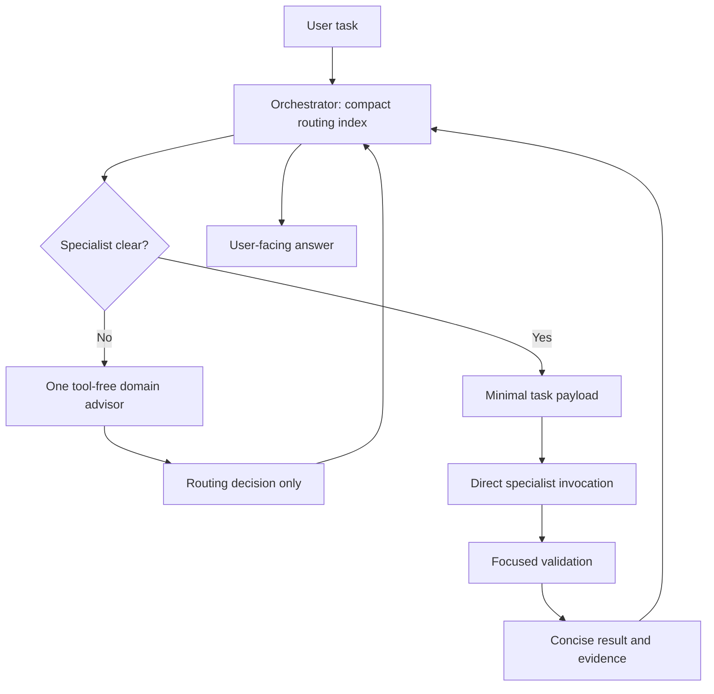
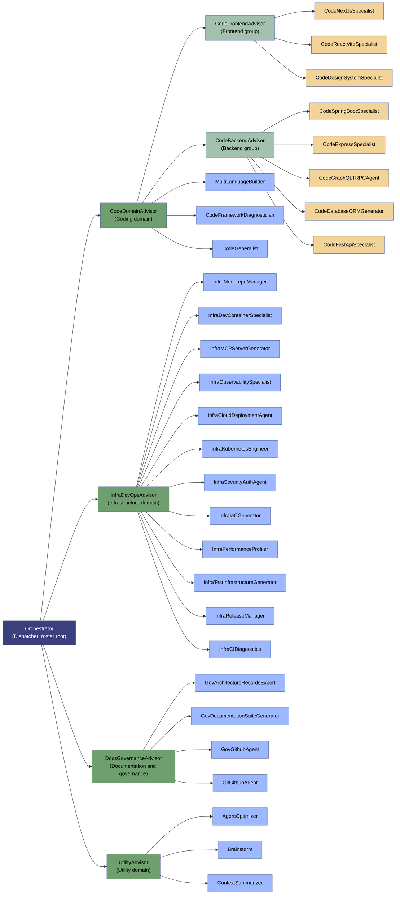

# Agent Roster

This folder holds the definitions of every agent available for routing. Each `.agent.md`
file is a self-contained prompt that governs one agent's behavior, tools, and triggers.

## Architecture

Execution and ownership are separate. **Orchestrator is the only dispatcher**
and directly invokes the selected worker. The compact routing catalog contains
names, ownership, and selection cues, not every specialist's full instructions.
The six former domain routers are now tool-free **advisors**. Clear tasks skip
them; ambiguous tasks consult at most one advisor, which returns a decision to
the dispatcher rather than invoking a worker.

Run Orchestrator as the main chat agent. Workers inspect relevant implementation
locally and return concise evidence. Do not copy whole prompts, chat history, or
unrelated file dumps into their payloads. Independent tasks may use separate
workers, but overlapping edits and dependent interfaces must be sequenced.

This reduces required routing hops and intentional context copying; it does not
guarantee a measured token or latency reduction. The runtime may still expose
agent names and descriptions for discovery. Full specialist prompts must not be
manually loaded into the dispatcher just to select a worker.

### Remote SSH Routing

Orchestrator embeds the compact worker selection index in its definition, so
ordinary dispatch does not need access to this folder or a local Windows path
from remote read/search tools. The JSON catalog remains the maintenance source;
update the embedded index alongside it when routes change. Do not search the
remote host for a catalog stored on the client. The selected worker must still
be exposed by the runtime agent tool; otherwise Orchestrator reports BLOCKED.

## Execution



The advisor and worker are separate calls from the main dispatcher. No subagent
needs to invoke another subagent. An advisor decision is not an execution receipt.

## Domain Organization

This graph groups agents by domain; it is not a call chain or approval hierarchy.
Each arrow places the right-hand agent in the left-hand group: read it as
"belongs to," not "invokes." Advisors do not supervise, approve, or invoke their
grouped specialists. Actual calls are shown separately in the Execution diagram.

The source of truth is [routing-catalog.json](routing-catalog.json). Each non-root
agent has exactly one organizational owner. CodeGeneralist is the coding fallback
worker; advisors return selection advice and never implement changes.




## Agent Index

| Agent | Role | User-invocable | Key Focus |
|---|---|---|---|
| **Orchestrator** | dispatcher | yes | Direct specialist dispatch, scoped payloads, concise synthesis |
| **CodeBackendAdvisor** | advisor | no | Optional backend specialist selection; never executes |
| **DocsGovernanceAdvisor** | advisor | no | Optional docs/governance specialist selection; never executes |
| **InfraDevOpsAdvisor** | advisor | no | Optional infrastructure/DevOps specialist selection; never executes |
| **UtilityAdvisor** | advisor | no | Optional utility specialist selection; never executes |
| **AgentOptimizer** | worker | yes | Diagnostics & optimization of a VS Code agent's definition, tools, and instructions |
| **GovArchitectureRecordsExpert** | worker | no | Manages ADRs and architectural alignments inside `./docs` |
| **Brainstorm** | worker | no | Divergent thinking: generates low-token architectural alternatives & edge cases |
| **CodeDomainAdvisor** | advisor | no | Optional cross-stack coding specialist selection; never executes |
| **CodeGeneralist** | worker | no | Generic implementation, review, debugging, and refactoring when no specialist fits |
| **ContextSummarizer** | worker | no | Read-only checkpoint summaries for observed context pressure or explicit requests; does not reset chat history or runtime context |
| **MultiLanguageBuilder** | worker | no | Polyglot builds across Python/Node.js/TypeScript with package management |
| **InfraDevContainerSpecialist** | worker | no | `.devcontainer/` scaffolding, Dockerfiles, remote SSH, container lifecycle |
| **InfraMCPServerGenerator** | worker | no | Model Context Protocol servers, JSON-RPC, editor integration |
| **CodeReactViteSpecialist** | worker | no | Frontend scaffolding: TypeScript + React + Vite + Vitest |
| **CodeFastApiSpecialist** | worker | no | Backend API scaffolding: FastAPI, Pydantic, SQLAlchemy |
| **InfraMonorepoManager** | worker | no | Multi-package workspace coordination & version synchronization |
| **InfraTestInfrastructureGenerator** | worker | no | Test suites across frameworks + CI/CD pipeline configuration |
| **GovDocumentationSuiteGenerator** | worker | no | ADRs, API docs, READMEs, user documentation |
| **InfraPerformanceProfiler** | worker | no | CPU/memory profiling for Python (Tachyon, Memray) and Node.js |
| **InfraReleaseManager** | worker | no | Version bumping, changelogs, Git tagging, publishing |
| **GovGithubAgent** | worker | no | Issue triage, GitHub Projects, agent capability proposal filing |
| **GitGithubAgent** | worker | yes | Local branches, scoped staging/commits, pushes, PR creation/updates/reviews/merges and authorized cleanup |
| **InfraCIDiagnostics** | worker | no | Root-cause diagnosis of failing CI/Actions jobs & PR errors, then suggests fixes |
| **CodeNextJsSpecialist** | worker | no | Next.js architecture: App Router, Server Components, ISR |
| **CodeSpringBootSpecialist** | worker | no | Java/Spring Boot backend scaffolding |
| **CodeDesignSystemSpecialist** | worker | no | Shared UI component libraries & design systems: React/Vue/Angular, theming/tokens, prop types, accessibility |
| **CodeDatabaseORMGenerator** | worker | no | Database schema & ORM setup: SQL/ORM scaffolding, migrations, indexes, constraints; SQLAlchemy/Prisma/Hibernate/Eloquent |
| **CodeFrontendAdvisor** | advisor | no | Optional frontend specialist selection; never executes |
| **CodeGraphQLTRPCAgent** | worker | no | GraphQL API & tRPC scaffolding: schema, resolvers, codegen (Apollo, Hasura, tRPC) |
| **CodeExpressSpecialist** | worker | no | Node.js/Express REST API generation & bootstrapping |
| **InfraCloudDeploymentAgent** | worker | no | Cross-cloud deployment & provisioning: cloud-init, pipelines, container orchestration (Azure DevOps, GitHub Actions) |
| **InfraIaCGenerator** | worker | no | Infrastructure-as-code generation: Bicep/ARM, Terraform, Pulumi |
| **InfraKubernetesEngineer** | worker | no | Kubernetes cluster engineering: Helm/Kustomize manifests, networking, RBAC |
| **InfraSecurityAuthAgent** | worker | no | Security hardening & authentication: RBAC, secrets, JWT/OAuth2/OpenID, compliance |
| **InfraObservabilitySpecialist** | worker | no | Observability engineering: error monitoring, tracing (OpenTelemetry), metrics, alerting |
| **CodeFrameworkDiagnostician** | worker | no | Local error parser & dependency validation for complex framework bugs |

## Routing Rules (Orchestrator)

1. Answer trivial factual questions directly. For work, choose the most-specific
    worker from the compact catalog; do not read every specialist definition.
2. Clear tasks go directly to one worker. Ambiguous tasks may consult one advisor
    with only the task, constraints, and relevant candidate catalog slice.
3. Advisors return JSON with `status`, `agent`, `reason`, and `missing_context`.
    Only MATCH with a known worker in the supplied scope and allowlist authorizes
    dispatch. NEEDS_INPUT requires clarification; NO_MATCH requires reassessment.
4. The dispatcher sends only goal/mode, relevant paths, constraints/approvals,
    acceptance checks, and essential verified evidence. Workers inspect local code.
5. Workers report concise findings/changes, artifact references, validation
    actually run, and blockers. Proposals do not become decisions without approval.
6. Fan out only disjoint independent work. Sequence overlapping edits. Allow one
    focused retry; escalate a real definition defect to AgentOptimizer once.
7. No advisor or worker delegates. No runtime compaction is promised. Do not force
    a checkpoint or questionnaire after each task.

## Code Validation Policy

This is a roster rule embedded in Orchestrator and all 22 implementation workers,
not a project instruction. It follows these agent definitions into target projects.
After modifying code, workers must run both the relevant tests and the target
repository's configured lint checks against the final changes. Focused validation
does not waive either requirement. Workers fix failures they introduce, rerun the
affected checks, and report unrelated failures without expanding scope.

Results must include exact commands and outcomes. Missing, unavailable, or blocked
checks must be reported as not run with the reason, never as passing. Existing tool
restrictions still apply; read-only advisors and non-executing writers do not gain
terminal access. Orchestrator includes this requirement in acceptance criteria and
must not present unverified changes as fully validated.

## Domain Map

| Domain Prefix | Advisor | Owned Agents |
|---|---|---|
| CODE_ | CodeDomainAdvisor | CodeFrontendAdvisor, CodeBackendAdvisor, MultiLanguageBuilder, CodeFrameworkDiagnostician, CodeGeneralist |
| CODE_ / Backend | CodeBackendAdvisor | CodeSpringBootSpecialist, CodeExpressSpecialist, CodeGraphQLTRPCAgent, CodeDatabaseORMGenerator, CodeFastApiSpecialist |
| CODE_ / Frontend | CodeFrontendAdvisor | CodeNextJsSpecialist, CodeReactViteSpecialist, CodeDesignSystemSpecialist |
| INFRA_/_DevOps | InfraDevOpsAdvisor | InfraMonorepoManager, InfraDevContainerSpecialist, InfraMCPServerGenerator, InfraCloudDeploymentAgent, InfraKubernetesEngineer, InfraSecurityAuthAgent, InfraIaCGenerator, InfraPerformanceProfiler, InfraTestInfrastructureGenerator, InfraReleaseManager, InfraCIDiagnostics, InfraObservabilitySpecialist |
| GOV_/_Docs | DocsGovernanceAdvisor | GovArchitectureRecordsExpert, GovDocumentationSuiteGenerator, GovGithubAgent, GitGithubAgent |
| Miscellaneous | UtilityAdvisor | AgentOptimizer, Brainstorm, ContextSummarizer |

## Tool Policy

Tool lists follow the agent's role, not a shared all-tools template. The validator
enforces required and allowed capabilities with `TOOL-1`; missing native search
must not silently become extra shell commands, and missing edit access must not
be worked around through terminal writes.

| Role | Required Tools | Optional or Restricted Tools |
|---|---|---|
| Orchestrator | `read/readFile`, `search`, `agent`, `vscode/askQuestions` | No edit, execution, GitHub, or web access |
| Six selection advisors | None | Explicit `tools: []` and `agents: []` |
| Implementation workers | `read`, `search`, `edit`, `execute` | `todo` optional; GitHub access only for InfraCIDiagnostics |
| Brainstorm and CodeFrameworkDiagnostician | `read`, `search` | No editing, execution, browsing, or delegation |
| ContextSummarizer | `read` | No editing, execution, or runtime compaction |
| AgentOptimizer and documentation/governance writers | `read`, `search`, `edit` | `todo` optional for GovDocumentationSuiteGenerator; no terminal access |
| GovGithubAgent | `read`, `search`, `execute`, `github/*` | Terminal limited by instructions to read-only repository inspection; no source editing |
| GitGithubAgent | `read`, `search`, `execute`, `github/*` | Scoped Git mutations only when requested, plus validation; no application source editing or delegation |

Tool availability is not authorization. Review/diagnosis stays read-only even for
a worker that can edit. CI fixes require an explicit request; deployment, commit,
publication, or data changes still require the relevant approval. Broad terminal
access is not a sandbox that technically enforces read-only command behavior.

GitHub's provider group is retained only for the three GitHub-facing workers;
provider-specific operation identifiers must be verified at runtime before
narrowing that group. CI diagnostics uses GitHub for read-only evidence, not
automatic repository mutations. No other agent receives this service group.

Documentation workers follow existing lint configuration and available editor
diagnostics. They cannot run CLI linters with their profile: report such checks
as not run unless execution evidence was supplied, and return the exact command
for a separately commissioned implementation worker. Never claim validation
from merely reading a command or configuration file.

These are statically checked role profiles, not proof of live MCP registration,
authentication, editor tool discovery, command safety, or measured context savings.

## Git Workflow

Select **GitGithubAgent** directly or let Orchestrator route branch, commit, push,
and PR tasks to it. It is user-level and follows the current repository's branch,
commit, validation, and PR-template conventions. GovGithubAgent remains responsible
for issue proposals; InfraReleaseManager owns releases and InfraCIDiagnostics owns
CI diagnosis.

Read-only preparation is the default. Explicit requests authorize the named
operation, not subsequent publication or cleanup. For example, "commit these
changes" does not authorize pushing or opening a PR; "push this branch and open
a draft PR against develop" does. The agent preserves unrelated work and staging,
checks the final staged diff, and reports validation evidence. Rewrites, force
pushes, merges, and branch deletions require explicit authorization for the target.
These are behavioral instructions, not a technical command sandbox.

## Model Policy

Start with the model selected in VS Code. Agent definitions currently omit both
`model` and `reasoning-effort`; the runtime resolves those defaults. Do not pin
a separate model for every framework or agent. This is the inherited baseline,
not automatic model switching or a claim that every available model is suitable.

| Role | Baseline | Candidate Override After Evaluation |
|---|---|---|
| Orchestrator | Inherited model with reliable reasoning and tool use | Prioritize correct dispatch and evidence handling over raw speed |
| Domain advisors | Inherited model | Fast, inexpensive model with reliable JSON and specialist selection |
| Implementation specialists and CodeGeneralist | Same inherited coding baseline | Strong coding model when focused task results justify it |
| Security, architecture, and complex diagnostics | Inherited model | Stronger reasoning for demonstrated difficult cases |
| ContextSummarizer | Inherited model | Accurate summarization with sufficient input capacity and state preservation |

Override rules:

- First evaluate a cheaper advisor model; do not assume low price means adequate
    selection accuracy. Keep the inherited baseline until the candidate passes.
- Use exact model identifiers available in the user's model picker and supported
    by the active harness. Confirm tool use, structured output, context capacity,
    and organization policy before adding frontmatter overrides.
- Where supported, `model` can be an ordered list of verified available fallback
    identifiers. An availability fallback is not task-aware model routing or a
    quality guarantee. Do not configure placeholders or guess model identifiers.
- Leave `reasoning-effort` unset unless the chosen model supports it and a
    measured task-specific benefit warrants a pin. Do not globally force high effort.
- If a configured model fails, use only an approved available fallback or report
    the blocker. Never silently downgrade a security-sensitive task to save cost.

Evaluation gate:

1. Compare the inherited baseline and candidate on the same representative tasks
     with equivalent payloads, tool permissions, and acceptance checks.
2. For advisors, include clear, ambiguous, missing-context, and out-of-domain cases.
     Check valid JSON, expected status, and selection of a worker from the supplied
     candidates, not another advisor or an invented agent.
3. For workers, check accepted outputs, regressions, scope compliance, and actual
     validation evidence. For summaries, check preservation of constraints, active
     failures, and essential contracts rather than brevity alone.
4. Record exact model identifiers, task outcomes, retries, elapsed time, and usage
     or cost when exposed. Compare total cost per successful task, including failed
     attempts and retries, not just the first call. Do not invent missing telemetry.
5. Pin only roles with demonstrated benefit without unacceptable quality loss.
     Keep the baseline when evidence is inconclusive and repeat the comparison
     after a model or harness change. Existing roster tests are not model benchmarks.

Model choice does not itself reduce the payload. The compact catalog, minimal
task context, local worker inspection, and concise results remain the context
controls. No candidate-model comparison or cheaper advisor pin is claimed here.

## Name Migration

Update saved agent selections and external workflow references to these names.
Old filenames were removed; no alias agents are installed. Tools, ownership, and
execution responsibilities are unchanged by this naming migration.

```text
WebDiagnosisExpert                       -> CodeFrameworkDiagnostician
CompactionExpert                         -> ContextSummarizer
InfraDevContainerOrchestrator             -> InfraDevContainerSpecialist
InfraPRCIErrDiagnosticFix                 -> InfraCIDiagnostics
CodeComponentLibraryDesignSystemAgent    -> CodeDesignSystemSpecialist
CodeTypeScriptReactViteGenerator          -> CodeReactViteSpecialist
ObservabilityAgent                       -> InfraObservabilitySpecialist
MiscAdvisor                              -> UtilityAdvisor
CodeNextjsGenerator                      -> CodeNextJsSpecialist
CodePythonFastAPIBuilder                 -> CodeFastApiSpecialist
CodeNodeJsExpressGenerator               -> CodeExpressSpecialist
CodeSpringBootGenerator                  -> CodeSpringBootSpecialist
```

## Notes

- Former DomainRouter definitions were renamed to Advisor definitions; select the
    updated names in saved workflows. Restart/select Orchestrator in a main chat
    when the editor has not refreshed its agent discovery list.
- Orchestrator's `agents:` is the direct invocation allowlist, not ownership.
    Advisors have `tools: []` and `agents: []`; workers have no delegation tool.
- The catalog controls ownership and selection cues; update it, the allowlist,
    and ownership documentation together when adding or renaming an agent.

## Validation

Run the static validator and its in-memory regression suite from this directory:

```powershell
python agent-roster-validator.py
python -m unittest -v test_agent_roster_validator
```

Python and PyYAML are required. Validation checks two distinct contracts: flat
runtime invocation from Orchestrator, and the catalog's single-parent ownership
tree with domain nesting and documentation parity. Catalog targets must resolve to
real workers, advisors must be tool-free, and role-specific required/allowed
tool profiles must match. Passing static checks does not
prove output quality, token savings, or runtime agent discovery.

## Runtime Verification

A prior nested-router smoke test on 2026-10-20 stopped at the coding router:
its subagent context had no agent-invocation tool. That failure motivated the
approved single-dispatcher contract. Do not invoke Orchestrator as a subagent and
expect it to delegate; it must be the main chat agent.

The main session exercised both replacement paths with read-only calls on 2026-10-20:

These results predate the naming-only migration above; the same definitions are
identified below by their current names. Runtime discovery under the new names
has not been re-tested; refresh agent selection after the migration.

- Direct worker: CodeReactViteSpecialist reviewed supplied JSX, found
    the missing stable key, and returned a minimal fix without files or commands.
- Optional advisor: CodeFrontendAdvisor returned MATCH for the shared component
    specialist. The main session checked that target against the supplied candidates
    and allowlist, then separately invoked CodeDesignSystemSpecialist.
    That worker returned a scoped approach without files, commands, or nested calls.

These tests verify direct invocation and advisor/worker separation in this session.
They are not a full automatic-routing evaluation of a fresh Orchestrator main
chat, nor a benchmark of context size or output quality. Select the updated
Orchestrator as the main chat agent to use the contract; running it inside another
subagent would reintroduce the known nesting limitation.
