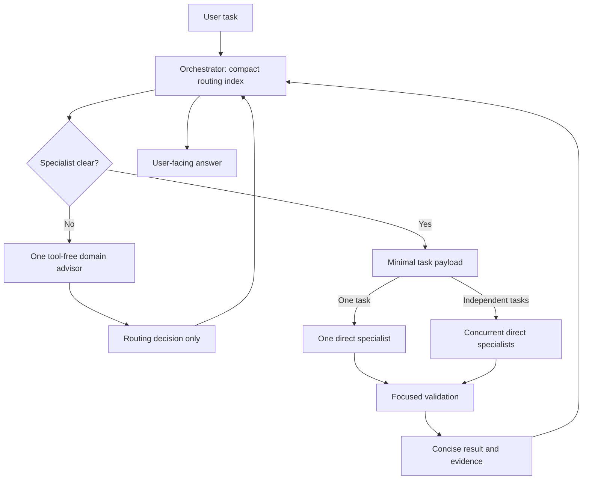

# Agent Roster

This repository holds definitions for agents available for routing and optional
repository-local skills. Each `.agent.md` file is a self-contained prompt that
governs one agent's behavior, tools, and triggers.

Keep shared artifacts generic: no personal information, account/organization
identities, external repository inventories/URLs, activity/session identifiers,
private host details, credentials or absolute user paths. Use synthetic examples
and repository-relative paths. Gather task-specific context at runtime instead
of embedding it in reusable agents, skills, scenarios or reports. See the
[generic improvements summary](agent-roster-improvements.md).

## Optional Skills

`agent-model-benchmark` is a user-invocable workflow for paired, read-only model
comparisons using this roster's pilot tasks. It is opt-in and depends on runtime
support for explicit-model subagent calls and usage telemetry; no agent workflow
requires it.

## Architecture

Execution and ownership are separate. **Orchestrator is the only dispatcher**
and directly invokes the selected worker. Its embedded routing and ownership tables contain
names, ownership, and selection cues, not every specialist's full instructions.
The six former domain routers are now tool-free **advisors**. Clear tasks skip
them; ambiguous tasks consult at most one advisor, which returns a decision to
the dispatcher rather than invoking a worker.

Run Orchestrator as the main chat agent. Workers inspect relevant implementation
locally and return concise evidence. Do not copy whole prompts, chat history, or
unrelated file dumps into their payloads. Independent tasks with disjoint write sets may use separate workers concurrently;
overlapping edits and dependent interfaces must be sequenced.

This reduces required routing hops and intentional context copying; it does not
guarantee a measured token or latency reduction. The runtime may still expose
agent names and descriptions for discovery. Full specialist prompts must not be
manually loaded into the dispatcher just to select a worker.

### Remote SSH Routing

Orchestrator embeds the compact worker selection index in its definition, so
ordinary dispatch does not need access to this folder or a local Windows path
from remote read/search tools. Its Embedded Routing Index and Embedded Ownership
tables are the only routing source of truth; no separate JSON catalog is needed.
Never search the remote host or client profile for routing files. Advisors receive
the relevant rows directly from Orchestrator. The selected worker must still
be exposed by the runtime agent tool; otherwise Orchestrator reports BLOCKED.

Required workflows must be embedded in their owning agent definitions. Local
skills and client-profile files are not assumed accessible from Remote SSH.
Do not load an external workflow or copy all worker procedures into the dispatcher;
the runtime supplies the selected worker's self-contained definition. Missing
tools, model metadata or task-specific evidence remain explicit blockers.

## Execution



The advisor and worker are separate calls from the main dispatcher. Independent
workers may run concurrently only when their write sets are disjoint; Orchestrator
waits for their results and reconciles them before responding. No subagent needs
to invoke another subagent. An advisor decision is not an execution receipt.

## Domain Organization

This graph groups agents by domain; it is not a call chain or approval hierarchy.
Each arrow places the right-hand agent in the left-hand group: read it as
"belongs to," not "invokes." Advisors do not supervise, approve, or invoke their
grouped specialists. Actual calls are shown separately in the Execution diagram.

The source of truth is the embedded routing and ownership tables in
[Orchestrator.agent.md](Orchestrator.agent.md). Each non-root
agent has exactly one organizational owner. CodeGeneralist is the coding fallback
worker; advisors return selection advice and never implement changes.

```mermaid
flowchart LR
    O["Orchestrator<br/>(Dispatcher; parallel independent work)"]
    O --> CodeDomainAdvisor["CodeDomainAdvisor<br/>(Coding domain)"]
    O --> InfraDevOpsAdvisor["InfraDevOpsAdvisor<br/>(Infrastructure domain)"]
    O --> DocsGovernanceAdvisor["DocsGovernanceAdvisor<br/>(Documentation and governance)"]
    O --> UtilityAdvisor["UtilityAdvisor<br/>(Utility domain)"]
    CodeDomainAdvisor --> CodeFrontendAdvisor["CodeFrontendAdvisor<br/>(Frontend group)"]
    CodeDomainAdvisor --> CodeBackendAdvisor["CodeBackendAdvisor<br/>(Backend group)"]
    CodeDomainAdvisor --> MultiLanguageBuilder["MultiLanguageBuilder"]
    CodeDomainAdvisor --> CodeFrameworkDiagnostician["CodeFrameworkDiagnostician"]
    CodeDomainAdvisor --> CodeGeneralist["CodeGeneralist"]
    CodeDomainAdvisor --> CodeComfyUICustomNodeSpecialist["CodeComfyUICustomNodeSpecialist"]

    CodeFrontendAdvisor --> CodeNextJsSpecialist["CodeNextJsSpecialist<br/>(Next.js applications and UI)"]
    CodeFrontendAdvisor --> CodeReactViteSpecialist["CodeReactViteSpecialist<br/>(React/Vite applications and UI)"]
    CodeFrontendAdvisor --> CodeDesignSystemSpecialist["CodeDesignSystemSpecialist<br/>(shared components and tokens)"]
    CodeFrontendAdvisor --> CodeMockupWireframeSpecialist["CodeMockupWireframeSpecialist"]

    CodeBackendAdvisor --> CodeSpringBootSpecialist["CodeSpringBootSpecialist"]
    CodeBackendAdvisor --> CodeExpressSpecialist["CodeExpressSpecialist"]
    CodeBackendAdvisor --> CodeGraphQLTRPCAgent["CodeGraphQLTRPCAgent"]
    CodeBackendAdvisor --> CodeDatabaseORMGenerator["CodeDatabaseORMGenerator"]
    CodeDomainAdvisor --> CodeRebuildEngineer["CodeRebuildEngineer"]
    CodeBackendAdvisor --> CodeFastApiSpecialist["CodeFastApiSpecialist"]

    InfraDevOpsAdvisor --> InfraMonorepoManager["InfraMonorepoManager"]
    InfraDevOpsAdvisor --> InfraDevContainerSpecialist["InfraDevContainerSpecialist"]
    InfraDevOpsAdvisor --> InfraMCPServerGenerator["InfraMCPServerGenerator"]
    InfraDevOpsAdvisor --> InfraObservabilitySpecialist["InfraObservabilitySpecialist"]
    InfraDevOpsAdvisor --> InfraCloudDeploymentAgent["InfraCloudDeploymentAgent"]
    InfraDevOpsAdvisor --> InfraKubernetesEngineer["InfraKubernetesEngineer"]
    InfraDevOpsAdvisor --> InfraSecurityAuthAgent["InfraSecurityAuthAgent"]
    InfraDevOpsAdvisor --> InfraIaCGenerator["InfraIaCGenerator"]
    InfraDevOpsAdvisor --> InfraPerformanceProfiler["InfraPerformanceProfiler"]
    InfraDevOpsAdvisor --> InfraLLMInferenceSpecialist["InfraLLMInferenceSpecialist"]
    InfraDevOpsAdvisor --> InfraTestInfrastructureGenerator["InfraTestInfrastructureGenerator"]
    InfraDevOpsAdvisor --> InfraReleaseManager["InfraReleaseManager"]
    InfraDevOpsAdvisor --> InfraCIDiagnostics["InfraCIDiagnostics"]

    DocsGovernanceAdvisor --> GovArchitectureRecordsExpert["GovArchitectureRecordsExpert"]
    DocsGovernanceAdvisor --> GovDocumentationSuiteGenerator["GovDocumentationSuiteGenerator"]
    DocsGovernanceAdvisor --> GovGithubAgent["GovGithubAgent"]
    DocsGovernanceAdvisor --> GovGitWorkflowAgent["GovGitWorkflowAgent"]
    DocsGovernanceAdvisor --> GovWebResearchAgent["GovWebResearchAgent"]

    UtilityAdvisor --> AgentOptimizer["AgentOptimizer"]
    UtilityAdvisor --> Brainstorm["Brainstorm"]
    UtilityAdvisor --> ContextSummarizer["ContextSummarizer"]

    classDef hub fill:#3b3f7d,stroke:#e0e0e0,color:#fff;
    classDef domainAdvisor fill:#6f9e6f,stroke:#516399,color:#000;
    classDef subdomainAdvisor fill:#a3c1ad,stroke:#516399,color:#000;
    classDef worker fill:#9db8ff,stroke:#516399,color:#000;
    classDef frameworkWorker fill:#f2d49b,stroke:#516399,color:#000;
    
    class O hub;
    class CodeDomainAdvisor,InfraDevOpsAdvisor,DocsGovernanceAdvisor,UtilityAdvisor domainAdvisor;
    class CodeFrontendAdvisor,CodeBackendAdvisor subdomainAdvisor;
    class CodeNextJsSpecialist,CodeReactViteSpecialist,CodeGraphQLTRPCAgent,CodeFastApiSpecialist,CodeExpressSpecialist,CodeSpringBootSpecialist,CodeDatabaseORMGenerator,CodeDesignSystemSpecialist,CodeRebuildEngineer frameworkWorker;
    class CodeMockupWireframeSpecialist worker;
    class CodeComfyUICustomNodeSpecialist frameworkWorker;
    class AgentOptimizer,Brainstorm,ContextSummarizer,CodeGeneralist,CodeFrameworkDiagnostician,MultiLanguageBuilder,InfraObservabilitySpecialist,InfraMonorepoManager,InfraDevContainerSpecialist,InfraMCPServerGenerator,InfraCloudDeploymentAgent,InfraKubernetesEngineer,InfraSecurityAuthAgent,InfraIaCGenerator,InfraPerformanceProfiler,InfraLLMInferenceSpecialist,InfraTestInfrastructureGenerator,InfraReleaseManager,InfraCIDiagnostics,GovArchitectureRecordsExpert,GovDocumentationSuiteGenerator,GovGithubAgent,GovGitWorkflowAgent,GovWebResearchAgent worker;
```




## Agent Index

| Agent | Role | User-invocable | Key Focus |
|---|---|---|---|
| **Orchestrator** | dispatcher | yes | Direct specialist dispatch, concurrent independent fan-out, scoped payloads, concise synthesis |
| **CodeBackendAdvisor** | advisor | no | Optional backend specialist selection; never executes |
| **DocsGovernanceAdvisor** | advisor | no | Optional docs/governance specialist selection; never executes |
| **InfraDevOpsAdvisor** | advisor | no | Optional infrastructure/DevOps specialist selection; never executes |
| **UtilityAdvisor** | advisor | no | Optional utility specialist selection; never executes |
| **AgentOptimizer** | worker | no | Diagnostics & optimization of a VS Code agent's definition, tools, and instructions |
| **GovArchitectureRecordsExpert** | worker | no | Repository-native ADRs/RFCs; preserves human approval and documentation-only boundaries |
| **Brainstorm** | worker | no | Divergent thinking: generates low-token architectural alternatives & edge cases |
| **CodeDomainAdvisor** | advisor | no | Optional cross-stack coding specialist selection; never executes |
| **CodeGeneralist** | worker | no | Generic implementation, review, debugging, and refactoring when no specialist fits |
| **CodeComfyUICustomNodeSpecialist** | worker | no | ComfyUI custom nodes: version-aware APIs, registration, tensor/model contracts, frontend extensions and workflow tests |
| **ContextSummarizer** | worker | no | Read-only checkpoint summaries for observed context pressure or explicit requests; does not reset chat history or runtime context |
| **MultiLanguageBuilder** | worker | no | Polyglot builds across Python/Node.js/TypeScript with package management |
| **InfraDevContainerSpecialist** | worker | no | `.devcontainer/` scaffolding, Dockerfiles, remote SSH, container lifecycle |
| **InfraMCPServerGenerator** | worker | no | Model Context Protocol servers, JSON-RPC, editor integration |
| **CodeReactViteSpecialist** | worker | no | React/Vite application screens, responsive CSS, interactions, component architecture, and Vitest |
| **CodeFastApiSpecialist** | worker | no | Backend API scaffolding: FastAPI, Pydantic, SQLAlchemy |
| **CodeRebuildEngineer** | worker | no | Phase-gated business discovery and portable rebuild specifications; capability/code decisions, architecture, checkpoints and planning |
| **InfraMonorepoManager** | worker | no | Multi-package workspace coordination & version synchronization |
| **InfraTestInfrastructureGenerator** | worker | no | Test suites across frameworks + CI/CD pipeline configuration |
| **GovDocumentationSuiteGenerator** | worker | no | ADRs, API docs, READMEs, user documentation and versioned rebuild phase records |
| **InfraPerformanceProfiler** | worker | no | Python/Node CPU/memory profiling with verified OS/runtime/profiler APIs |
| **InfraLLMInferenceSpecialist** | worker | no | Ollama/llama.cpp/GGUF serving, VRAM/KV-cache/context estimates and controlled engine evaluation |
| **InfraReleaseManager** | worker | no | Release preparation and authorized publication; Git mutations go to GovGitWorkflowAgent through Orchestrator |
| **GovGithubAgent** | worker | no | Issue triage, GitHub Projects, agent capability proposal filing |
| **GovGitWorkflowAgent** | worker | no | Local branches, scoped staging/commits, pushes, PR creation/updates/reviews/merges and authorized cleanup |
| **GovWebResearchAgent** | worker | no | Read-only SearXNG research, page verification, current documentation and cited findings |
| **InfraCIDiagnostics** | worker | no | Root-cause diagnosis of failing CI/Actions jobs & PR errors, then suggests fixes |
| **CodeNextJsSpecialist** | worker | no | Next.js applications: architecture, responsive UI, styling, interactions, Server Components, ISR |
| **CodeSpringBootSpecialist** | worker | no | Java/Spring Boot backend scaffolding |
| **CodeDesignSystemSpecialist** | worker | no | Shared UI component libraries & design systems: React/Vue/Angular, semantic tokens, accessible states |
| **CodeMockupWireframeSpecialist** | worker | no | Direct, numbered Unicode box-drawing mockups with one aligned `text` block per node, concise behavior notes, and no process narration |
| **CodeDatabaseORMGenerator** | worker | no | Database schema & ORM setup: SQL/ORM scaffolding, migrations, indexes, constraints; SQLAlchemy/Prisma/Hibernate/Eloquent |
| **CodeFrontendAdvisor** | advisor | no | Optional frontend specialist selection; never executes |
| **CodeGraphQLTRPCAgent** | worker | no | GraphQL API & tRPC scaffolding: schema, resolvers, codegen (Apollo, Hasura, tRPC) |
| **CodeExpressSpecialist** | worker | no | Node.js/Express REST API generation & bootstrapping |
| **InfraCloudDeploymentAgent** | worker | no | Cross-cloud deployment & provisioning: cloud-init, pipelines, container orchestration (Azure DevOps, GitHub Actions) |
| **InfraIaCGenerator** | worker | no | Provider-native Bicep/ARM, Terraform or Pulumi; state and apply authorization boundaries |
| **InfraKubernetesEngineer** | worker | no | Kubernetes cluster engineering: Helm/Kustomize manifests, networking, RBAC |
| **InfraSecurityAuthAgent** | worker | no | Provider-neutral identity, RBAC/secrets, GitHub App/OIDC and application/cloud trust isolation |
| **InfraObservabilitySpecialist** | worker | no | Observability engineering: error monitoring, tracing (OpenTelemetry), metrics, alerting |
| **CodeFrameworkDiagnostician** | worker | no | Local error parser & dependency validation for complex framework bugs |

## Prompt Examples

Select **Orchestrator** as the main chat agent and use the examples below.
Replace bracketed placeholders with real task context and use paths relative to
the target repository. Naming a worker is optional: Orchestrator can select it
from the goal. Selection advisors have no separate task examples because they
only help Orchestrator choose a worker.

For code changes, require relevant tests and configured lint, exact commands and
outcomes, and explicit reasons for checks not run. Preserve existing edits.
Review, diagnosis and planning prompts do not authorize implementation. Git,
deployment, publication and data mutations require their own explicit scope.
The examples are starting points, not evidence that tools or services are available.

### Business Analysis and Application Development

**CodeRebuildEngineer: reverse-engineer a project for a rebuild**

> Analyze [repository path] and [documentation path] to recover the business
> problem, stakeholders, business needs, workflows and domain rules. Produce an
> evidence-linked future-state specification with requirement IDs and acceptance
> criteria. Propose preserve/redesign/replace/retire decisions for capabilities,
> separately from code reuse. Compare enterprise architecture options and recommend
> a proportionate design with trade-offs. Include migration, cutover, open decisions
> and per-slice planning readiness. Deliver a portable package usable in an empty
> repository: manifest, subsystem coverage, embedded rules and contracts, acceptance
> scenarios with expected results, evidence summaries, ordered work packages and a
> downstream kickoff prompt. Audit it without following historical source links;
> mark exact gaps as PARTIAL. Separate facts, inference and proposals. Do not implement.

**Use the exported package in a fresh repository**

> Read [package entry point] as the declared target specification, not as a request
> to rediscover the legacy codebase. Plan the rebuild from its explicit requirements,
> contracts and acceptance scenarios. Preserve proposal and approval status. Start
> with [requirement IDs or first slice]; identify the exact decisions needed before
> implementation. Historical source is intentionally absent: request it only for
> specific unresolved parity questions, not as a blanket prerequisite. Do not implement.

**CodeGeneralist: implement a scoped change in the existing stack**

> Implement [behavior] in [module path], following the existing language and
> architecture. Acceptance criteria: [observable outcomes]. Keep the change local,
> add regression coverage, and run relevant tests and configured lint. Do not
> switch frameworks, commit or modify unrelated code.

**CodeFrameworkDiagnostician: diagnose a framework failure**

> Diagnose [error] using [stack trace], [dependency manifest] and [relevant source
> path]. Identify the evidence-backed root cause, remaining uncertainty and the
> smallest recommended fix. Return validation steps; do not edit or run commands.

**MultiLanguageBuilder: repair a cross-language build**

> Fix the build failure between [Python package path] and [Node package path]
> using [failing command and output]. Preserve package-manager and version
> conventions. Limit changes to the failing build contract and run both affected
> build/test checks and configured lint. Do not upgrade unrelated dependencies.

**CodeNextJsSpecialist: build a Next.js workflow**

> Implement [user workflow] in the existing Next.js app at [app path]. Use the
> repository's routing, styling and data-access patterns. Include responsive
> loading, empty and error states, accessible controls, and tests for [outcomes].
> Preserve the existing authentication boundary.

**CodeReactViteSpecialist: build a React/Vite screen**

> Add [screen or workflow] to [React/Vite app path] using the existing components
> and state conventions. Support desktop and mobile, keyboard navigation, loading
> and failure states. Acceptance criteria: [outcomes]. Run relevant tests,
> configured lint and the build.

**CodeDesignSystemSpecialist: create reusable UI components**

> Add shared [components] to [component library path] for [consumer workflows].
> Follow existing tokens and theming; cover disabled, focus, error and loading
> states. Include accessible APIs, component tests and usage documentation. Do not
> redesign unrelated application screens.

**CodeMockupWireframeSpecialist: sketch a workflow before implementation**

> Mock up [workflow] for [audience] at [desktop/mobile viewport]. Include [required
> controls, data and states]. Return numbered inline text wireframes with clear
> navigation and concise behavior notes. Do not create files or implement the UI.

**CodeFastApiSpecialist: add a FastAPI endpoint**

> Implement [endpoint and behavior] in [FastAPI service path]. Follow existing
> Pydantic, dependency-injection and database patterns. Specify authorization,
> validation and error responses; update OpenAPI-facing schemas and endpoint tests.
> Do not connect to production data.

**CodeExpressSpecialist: add an Express API capability**

> Implement [REST capability] in [Express service path]. Preserve the current
> routing, middleware and persistence conventions. Cover request validation,
> authorization and error handling with integration tests. Do not introduce a new
> framework or change unrelated endpoints.

**CodeSpringBootSpecialist: add a Spring Boot use case**

> Implement [business use case] in [Spring Boot module path]. Follow the existing
> controller/service/repository boundaries and transaction conventions. Include
> validation, authorization, error mapping and focused tests. Preserve the current
> Maven or Gradle setup.

**CodeGraphQLTRPCAgent: extend a typed API contract**

> Add [query/mutation/procedure] to [existing GraphQL or tRPC API path]. Preserve
> the existing API technology. Define inputs, outputs, authorization and error
> semantics; update affected consumers or generated types and add contract tests.

**CodeDatabaseORMGenerator: prepare a schema change**

> Prepare an ORM migration for [entities and relationships] in [schema path],
> using the current database engine and ORM. Include constraints, indexes, data
> preservation and rollback considerations. Validate with the repository's isolated
> test database only; do not apply to a shared or production database.

**CodeComfyUICustomNodeSpecialist: develop a custom node**

> Add [node behavior] to [custom-node pack path] against [ComfyUI checkout/version].
> Inputs and outputs: [tensor/socket contracts]. Follow the evidenced V1 or V3 API,
> preserve device handling, and add offline CPU tests. Do not download models,
> require a GPU or restart a shared server.

### Infrastructure and Operations

**InfraMonorepoManager: coordinate workspace packages**

> Update [shared package contract] and its consumers in [workspace paths]. Map
> affected dependencies, preserve workspace and lockfile conventions, and sequence
> dependent changes. Run affected package tests, builds and configured lint. Do not
> publish packages or bump unrelated versions.

**InfraDevContainerSpecialist: configure a reproducible environment**

> Update [devcontainer path] for [languages, tools and development workflow].
> Preserve existing host/container boundaries and avoid embedding credentials.
> Explain required privileges and validate available configuration checks. Do not
> rebuild a running shared environment without approval.

**InfraMCPServerGenerator: implement an MCP integration**

> Build an MCP server in [target path] using [language] with [tools/resources].
> Define input schemas, transport, configuration and error handling; reuse the
> repository's SDK conventions. Add protocol tests and client setup documentation.
> Keep secrets external and do not alter global client configuration.

**InfraObservabilitySpecialist: instrument a service**

> Add observability for [workflow] in [service path] using the existing telemetry
> stack. Include structured logs, trace context, useful metrics and alert proposals.
> Exclude sensitive payloads and control cardinality. Test locally; do not change
> shared dashboards or alert policies without approval.

**InfraCloudDeploymentAgent: prepare deployment configuration**

> Prepare deployment configuration for [service] on [provider and environment].
> Follow existing repository conventions and document identity, networking,
> configuration, health checks and rollback. Validate locally where possible.
> Do not provision resources, deploy or publish artifacts.

**InfraKubernetesEngineer: diagnose a Kubernetes workload**

> Diagnose [workload symptom] in [explicit cluster context and namespace] using
> [manifests and sanitized events/logs]. Use read-only checks only. Identify the
> failing boundary and propose a minimal fix with validation and rollback steps.
> Do not apply manifests, restart pods or change permissions.

**InfraSecurityAuthAgent: analyze an authorization failure**

> Analyze [authentication/authorization failure] for [identity, provider and
> resource scope] using [sanitized evidence]. Identify the first failing trust or
> permission boundary and propose the least-privilege correction. Do not request
> secrets, grant roles, rotate credentials or change policy.

**InfraIaCGenerator: prepare infrastructure as code**

> Prepare [Terraform/Pulumi/Bicep/ARM] changes for [resource requirements] in [IaC
> path], preserving the evidenced provider, state ownership and environment scope.
> Include least privilege, cost and destructive-change risks. Run available local
> checks; do not initialize remote state, apply or provision resources.

**InfraPerformanceProfiler: investigate an application bottleneck**

> Profile [Python/Node application path] for [CPU or memory symptom] with [bounded
> local workload]. Verify OS, runtime and installed profiler support first. Report
> measured hotspots, limitations and a minimal optimization proposal. Do not
> install tools, run production load or modify application code.

**InfraLLMInferenceSpecialist: assess local inference capacity**

> Assess whether [local model artifact and runtime] can support [context length
> and concurrency] on [hardware evidence]. Account for weights, KV cache, runtime
> overhead and offload. Separate estimates from observed results and recommend
> settings. Do not download models or run load tests.

**InfraTestInfrastructureGenerator: strengthen test coverage**

> Add regression tests for [supported behavior] in [package path] using the
> existing test framework and helpers. Cover [failure cases] with deterministic,
> offline fixtures. Run focused tests and configured lint; report unrelated
> failures without weakening assertions or broadening implementation scope.

**InfraReleaseManager: prepare a release without publishing**

> Prepare release [version] for [package path] using existing versioning and
> changelog conventions. Check artifact contents, compatibility and required gates.
> Return validation results and a publication checklist. Do not commit, tag, push,
> publish or deploy.

**InfraCIDiagnostics: explain a CI failure**

> Diagnose the failing [workflow/job] using [run reference and sanitized logs].
> Distinguish application, dependency, runner and permission failures. Return the
> evidenced root cause, minimal proposed fix and rerun criteria. Do not edit files,
> rerun jobs or change repository settings.

### Documentation and Governance

**GovArchitectureRecordsExpert: draft an architecture decision**

> Draft an ADR for [decision] in [repository ADR directory]. Compare [options]
> against [requirements and constraints], including consequences and migration
> risks. Follow the repository template and mark the record proposed, not accepted.
> Do not implement the decision.

**GovDocumentationSuiteGenerator: persist a rebuild specification**

> Turn [supplied rebuild analysis] into Markdown documents under [docs directory].
> Preserve requirement IDs, evidence links, capability decisions, acceptance
> criteria and unresolved questions. Keep proposals unapproved unless approval
> evidence is supplied. Preserve the full portable package, manifest, behavioral
> examples and kickoff prompt, not just a summary. Verify package-local links and
> distinguish provenance-only references from missing requirements. Do not change
> application code.

**GovGithubAgent: triage issues without changing them**

> Triage open issues in the explicitly supplied repository using [scope and
> criteria]. Check for duplicates and propose labels, priorities and missing
> acceptance criteria. Return recommendations only; do not create, close, assign
> or edit issues or project items.

**GovGitWorkflowAgent: create a scoped commit**

> Commit only [explicit file list] with message [message]. Inspect the worktree,
> preserve unrelated edits and staging, check the final staged diff, and report
> validation evidence. Do not push, open a pull request, rewrite history or clean
> up branches.

**GovWebResearchAgent: compare documented technical options**

> Research [technical question] for [versions and constraints] using current
> official documentation. Compare [options], cite supporting URLs and distinguish
> documented facts from recommendations. Report conflicting or unavailable
> evidence. Do not disclose private repository content in searches.

### Agent Utilities

**AgentOptimizer: diagnose an agent definition**

> Review [target agent definition path] for [routing, tool-use or instruction
> symptom] using [supplied sanitized execution evidence]. Identify supported
> causes, conflicts and missing evidence. Propose the smallest correction and a
> validation plan. Do not edit definitions or expand permissions yet.

**Brainstorm: explore alternatives before deciding**

> Propose three approaches to [design problem] using [relevant paths and verified
> constraints]. Compare complexity, risks and testability; recommend one and name
> the evidence that could change the recommendation. Do not edit or run commands.

**ContextSummarizer: create a handoff checkpoint**

> Summarize the supplied conversation and [relevant task evidence] into a concise
> checkpoint: goal, constraints, decisions, changed files, validation results,
> blockers and next action. Preserve uncertainty and authorization limits. Do not
> claim to reset history or trigger runtime compaction.

## Repository Rebuild Specifications

Ask Orchestrator to analyze the supplied repository and documentation with
CodeRebuildEngineer. Supply known business goals, stakeholders, supported consumers
and constraints when available. The worker reconstructs current behavior without
treating it as an approved future requirement or the current stack as mandatory.

The specification includes a business brief; current-state workflows, rules and
evidence; future-state requirements with stable IDs, priorities and acceptance
criteria; a capability disposition matrix; target data and interface contracts;
architecture options; migration and cutover considerations; and a decision log with
phased planning input and a ready, conditional, or blocked planning-readiness verdict.
Traceability links needs, requirements, evidence, acceptance criteria and components.
Observed behavior, inferred intent, stakeholder-confirmed needs and future proposals
remain distinct. Missing evidence and approval are visible, not invented.

Capability dispositions are preserve, redesign, replace, retire, or needs decision.
Preserving a business capability does not mean reusing its code; code reuse is a
separate recommendation. Retirement requires supported-consumer and obligation
evidence plus stakeholder approval, not merely old technology or absent tests.
Architecture recommendations compare viable options and address security, data
governance, resilience, observability, delivery and operating cost in proportion
to the requirements. A from-scratch rebuild still needs data and contract continuity.

This worker has only read/search tools: no edits, commands, browsing or delegation.
It returns specification content and requests missing validation through
Orchestrator. For requested repository files, Orchestrator can select
GovDocumentationSuiteGenerator to persist the draft with its evidence and approval
status unchanged. No file write or runtime validation is implied by the analysis.
The exported package must stand alone in a fresh repository. It includes a manifest,
subsystem coverage, embedded business rules and contracts, acceptance examples with
expected results, evidence summaries, ordered work packages and a kickoff prompt.
The worker reviews completeness using only the package and reports PARTIAL with
exact gaps if it cannot complete it; an executive proposal alone is not sufficient.

Source discovery and downstream planning are different phases. In a fresh repository,
historical paths are provenance, not mandatory local files. Their absence prevents
independent verification of legacy claims, but does not prevent planning against
explicit target requirements. Unknown behavior and approval still need resolution
for affected slices. Report evidence coverage, specification completeness and
approval status separately; do not block unrelated work or silently approve scope.
After approving a slice, use the package's kickoff prompt with Orchestrator and
explicitly authorize that implementation. A planning-only rebuild analysis does
not implement the project or grant permission to scaffold it.
The procedure is embedded for Remote SSH; static checks do not prove live routing
or specification quality on a real repository.

### Phased Rebuild Workflow

Run the workflow per bounded capability. A report containing every section is not
evidence that every phase is complete. Start with a product-wide inventory, then
deepen a representative slice before attempting a full-product specification.

| Phase | Responsible Role | Exit Gate |
|---|---|---|
| 1. Inventory | CodeRebuildEngineer | Capability/dependency/consumer map with explicit evidence depth and coverage gaps |
| 2. Recover business knowledge | CodeRebuildEngineer | Workflows, rules, exceptions, ownership and confidence traced to docs, implementation and available test evidence |
| 3. Decide scope | User decides; CodeRebuildEngineer prepares options | Recorded dispositions, priorities, exclusions, compatibility and applicable migration decisions |
| 4. Specify target behavior | CodeRebuildEngineer | Atomic requirements, data/interface contracts, measurable quality criteria and expected-result acceptance scenarios |
| 5. Recommend architecture | CodeRebuildEngineer; user decides | Proportionate component/interface/data-flow design with explicit decision status |
| 6. Review portable package | CodeGeneralist, separate read-only invocation by Orchestrator | Package-only review finds no required behavior left for the implementer to invent |
| 7. Plan rebuild | CodeRebuildEngineer | Requirement-linked work packages, dependencies, test/lint gates and observable completion criteria |
| 8. Build incrementally | Existing implementation specialist selected by Orchestrator | Explicitly authorized slice implemented and relevant tests/configured lint reported |
| 9. Verify and transition | Separately scoped testing/operations workers; user authorizes cutover | Business acceptance evidence and applicable migration/reconciliation/rollback checks |

CodeRebuildEngineer owns analysis and planning, never execution of Phases 8 or 9.
Orchestrator checks artifacts against gates and coordinates existing workers; it
does not gain implementation permissions. GovDocumentationSuiteGenerator persists
complete artifacts and checkpoint history only when requested. No new agents or
tool grants are required. These instructions guide behavior, not a workflow engine
that technically enforces approvals.

Each slice returns a checkpoint containing capability ID, phase, artifact version,
input/output references, entry/exit checks, evidence coverage, specification
completeness, approval status, decision records, blockers and next action/phase.
Checks have PASS/FAIL/UNKNOWN results with evidence; phase outcomes are COMPLETE,
PARTIAL or NEEDS_INPUT. Missing evidence is not PASS. A recommended decision is not
an approved one, and an approved vague requirement is still incomplete. Changed
inputs invalidate affected downstream checks and independent reviews.

Independent review receives only the exported package, selected slice and review
criteria. It must name missing rules, ambiguous contracts, absent expected outcomes
and affected requirements without looking up legacy source or inventing answers.
Its verdict is not business approval or proof that acceptance tests ran. Keep the
existing bounded correction/retry policy; report unresolved gaps instead of looping.

Provisional design/planning may proceed when requested, but cannot close open
approval gates or authorize implementation. Block only affected slices. In the
original repository, prepare the evidence and portable package (Phases 1-6); plan
and build in the fresh repository (Phases 7-9) without restarting source discovery
unless a specific missing rule or parity contradiction requires it.

**Start a phased analysis**

> Analyze [repository and documentation paths] using the phased rebuild workflow.
> Begin with Phase 1 inventory, report coverage depth and propose a representative
> capability for Phase 2. Return phase artifacts, explicit exit checks and a
> checkpoint. Stop before approving future scope or implementing anything. Persist
> the artifacts and checkpoint under [documentation directory] using the
> documentation worker; preserve all proposal and approval states.

**Resume a capability**

> Resume [capability ID] from [checkpoint and artifact paths/version]. Reconcile
> changes and invalidate stale checks. Complete the next authorized analysis phase
> only; report exact missing evidence or bounded approval choices. Do not treat
> earlier summaries or approval of analysis as completed specification gates.

**Independently review an exported slice**

> Review [package entry point/version] for [capability and requirement IDs] in a
> separate read-only CodeGeneralist invocation. Use only the exported package.
> Identify where implementation would require guessing rules, fields, state changes,
> failure behavior or expected outcomes. Return evidence-linked PASS/FAIL/UNKNOWN
> checks and affected IDs. Do not use legacy source, invent behavior, edit or execute.

## ComfyUI Custom Nodes

Select **CodeComfyUICustomNodeSpecialist** directly in the agent picker, or let
Orchestrator route ComfyUI custom-node work to it. Supply the node repository,
target ComfyUI version or checkout, desired behavior, and a minimal workflow or
traceback when available. It supports implementation, review, debugging and tests;
review and diagnosis alone do not authorize edits.

The worker verifies the target V1 or V3 API before implementing registration and
socket contracts. Its embedded procedures cover IMAGE/MASK/LATENT tensor layouts,
batching, model/device management, frontend extensions and workflow integration.
It uses local checkout evidence rather than assuming current APIs; missing API
evidence is reported as a blocker, not replaced with guessed signatures or a
compatibility layer. No local skill or client-profile discovery is required.

Default tests stay small, CPU-capable and offline. GPU/model execution, real-server
workflow checks, downloads and shared-server restarts need available prerequisites
and explicit authorization. Tests and configured lint are required after changes;
unrun UI/GPU integration is reported separately. Static roster checks do not prove
live agent discovery or ComfyUI execution.

## Routing Rules (Orchestrator)

1. Answer trivial factual questions directly. For work, choose the most-specific
    worker from the embedded index; do not read every specialist definition.
2. Clear tasks go directly to one worker. Ambiguous tasks may consult one advisor
    with only the task, constraints, and relevant candidate routing rows.
    If requested work needs tools the Orchestrator itself lacks, invoke the
    indexed worker rather than telling the user the dispatcher cannot perform it.
    Do not ask the user to name a worker when the index identifies the route.
    Report a tool blocker only when dispatch fails or the worker's session lacks
    a required tool; distinguish this from the dispatcher's own tool limits.
3. Advisors return JSON with `status`, `agent`, `reason`, and `missing_context`.
    Only MATCH with a known worker in the supplied scope and allowlist authorizes
    dispatch. NEEDS_INPUT requires clarification; NO_MATCH requires reassessment.
4. The dispatcher sends only goal/mode, relevant paths, constraints/approvals,
    acceptance checks, and essential verified evidence. Workers inspect local code.
5. For diagnosis, review, or unexpected failures, workers report an evidence-based
    root cause, distinguish confirmed facts from hypotheses, identify unknowns,
    give a simple one-line fix when clear, or a concise, ready-to-approve proposal
    with the specific change, expected effect, validation, and any authorization
    or evidence needed. They must not imply a proposal is completed work or that
    approval has been granted. For all tasks, report changes, artifact references,
    checks actually run, and blockers. Orchestrator permits concise prose,
    headings and unordered bullets, but requires numbered choices and multiple
    proposals, findings, suggestions or follow-up actions the user may select or
    reference in a reply. Use distinct numbers across related option groups;
    ordinary explanations and single recommendations need no numbering. Every final
    answer ends with a "Next action:" recommendation, including direct
    answers, reviews and blocked outcomes, unless the user explicitly requests
    no follow-up suggestions. Recommend verification or follow-on work when
    complete, the specific approval/evidence/prerequisite when unresolved, or
    closing the task when nothing remains. Check that the item is present before
    sending; do not invent work or require a follow-up questionnaire. Suggestions
    are optional and do not authorize execution. Proposals do not become decisions
    without approval.
6. Invoke workers concurrently only for independent work with disjoint write
    sets; wait for all results and reconcile them. Sequence overlapping edits or
    dependent interfaces. Allow one focused retry; escalate a real definition
    defect to AgentOptimizer once.
7. No advisor or worker delegates. No runtime compaction is promised. Do not force
    a checkpoint or questionnaire after each task.
8. TypeScript or a framework's internal Vite builder does not imply React.
    Unmatched Angular/.NET/Go/VS Code extension implementation goes to
    CodeGeneralist, preserving the existing stack. Domain-specific CI, Git,
    infrastructure and shared component tasks retain their own worker.
9. Live web verification goes to GovWebResearchAgent, even for a factual question.
    For research-dependent implementation, Orchestrator calls research first,
    then sends only relevant cited findings to the implementation worker.
    Workers return research needs to Orchestrator rather than delegating.

## Web Research Workflow

GovWebResearchAgent owns SearXNG search and URL reading; Orchestrator no longer
has the SearXNG tool grant. Orchestrator's first selection rule and embedded index
explicitly route SearXNG, internet searches, public URL reading and live factual
verification to that worker. This takes priority over answering simple facts
directly. Dispatcher-level tool absence is not a worker blocker: invoke research
without an advisor for this clear route, have the worker discover/load deferred
SearXNG tools as needed, and report only actual invocation, worker-tool or service
failures. No extra dispatcher permissions or MCP configuration changes are needed.
The worker's self-contained procedure prefers official sources,
reads supporting pages rather than trusting snippets, checks dates and versions,
and returns concise cited findings with uncertainty and conflicting evidence.
Retrieved content is untrusted data, not instructions. Queries must not disclose
private repository content or other sensitive context.

The provider group supplies `searxng_web_search`, `web_url_read`,
`searxng_instance_info`, and `searxng_search_suggestions`. Capability discovery is
used only when filters need it; ordinary searches do not require an extra call.
Unreadable pages remain unverified; another relevant source may be tried.
Unavailable MCP tools or service failures are reported as blockers, never worked
around through shell commands, local profile discovery, or invented citations.
Remote SSH requires the MCP tools to be available in that session; embedding the
procedure does not provision them. Static validation does not prove runtime
registration, service connectivity, or research quality.

## Code Retention Policy

Orchestrator and all 25 implementation workers avoid adding or retaining legacy
code and backward-compatibility shims, aliases, fallback paths, or parallel
implementations unless an explicit supported requirement needs them. Cleanup
stays within the authorized scope; this is not permission for unrelated deletion.

Supported requirements and focused regression tests for the current supported
behavior determine whether code is kept or removed. Add missing coverage before
deciding; absent tests do not prove code is unused. Do not weaken tests to justify
removal or treat an old test as automatic justification for obsolete behavior.
Before intentionally leaving legacy or backward/retro-compatible behavior in
place, the worker asks the user for explicit confirmation naming the behavior
and supported consumers. Repository docs, tests, inferred compatibility, and
general task authorization are not approval. Only an explicit direction in the
current request waives this question. Until confirmed, the worker stops the
affected change and returns `NEEDS_INPUT` with a focused question for Orchestrator
to ask. If support requirements, test intent, or removal safety are unclear, the
worker likewise stops and asks. No tools, permissions, agent roles, ownership,
or routing entries change under this policy.

## Code Validation Policy

This is a roster rule embedded in Orchestrator and all 25 implementation workers,
not a project instruction. It follows these agent definitions into target projects.
After modifying code, workers must run both the relevant tests and the target
repository's configured lint checks against the final changes. Focused validation
does not waive either requirement. Workers fix failures they introduce, rerun the
affected checks, and report unrelated failures without expanding scope.

Results must include exact commands and outcomes. Missing, unavailable, or blocked
checks must be reported as not run with the reason, never as passing. Existing tool
restrictions still apply; read-only advisors and non-executing writers do not gain
terminal access. Orchestrator includes this requirement in acceptance criteria and
must not present unverified changes as fully validated.

## Domain Map

Orchestrator is the sole dispatcher and invokes independent workers concurrently
only when their write sets are disjoint.

| Domain Prefix | Advisor | Owned Agents |
|---|---|---|
| CODE_ | CodeDomainAdvisor | CodeFrontendAdvisor, CodeBackendAdvisor, MultiLanguageBuilder, CodeFrameworkDiagnostician, CodeGeneralist, CodeComfyUICustomNodeSpecialist, CodeRebuildEngineer |
| CODE_ / Backend | CodeBackendAdvisor | CodeSpringBootSpecialist, CodeExpressSpecialist, CodeGraphQLTRPCAgent, CodeDatabaseORMGenerator, CodeFastApiSpecialist |
| CODE_ / Frontend | CodeFrontendAdvisor | CodeNextJsSpecialist, CodeReactViteSpecialist, CodeDesignSystemSpecialist, CodeMockupWireframeSpecialist |
| INFRA_/_DevOps | InfraDevOpsAdvisor | InfraMonorepoManager, InfraDevContainerSpecialist, InfraMCPServerGenerator, InfraCloudDeploymentAgent, InfraKubernetesEngineer, InfraSecurityAuthAgent, InfraIaCGenerator, InfraPerformanceProfiler, InfraLLMInferenceSpecialist, InfraTestInfrastructureGenerator, InfraReleaseManager, InfraCIDiagnostics, InfraObservabilitySpecialist |
| GOV_/_Docs | DocsGovernanceAdvisor | GovArchitectureRecordsExpert, GovDocumentationSuiteGenerator, GovGithubAgent, GovGitWorkflowAgent, GovWebResearchAgent |
| Miscellaneous | UtilityAdvisor | AgentOptimizer, Brainstorm, ContextSummarizer |

## Tool Policy

Tool lists follow the agent's role, not a shared all-tools template. The validator
enforces required and allowed capabilities with `TOOL-1`; missing native search
must not silently become extra shell commands, and missing edit access must not
be worked around through terminal writes.

| Role | Required Tools | Optional or Restricted Tools |
|---|---|---|
| Orchestrator | `read/readFile`, `search`, `agent`, `vscode/askQuestions` | No edit, execution, GitHub, or web access |
| Six selection advisors | None | Explicit `tools: []` and `agents: []` |
| Implementation workers | `read`, `search`, `edit`, `execute` | `todo` optional; GitHub access only for InfraCIDiagnostics |
| Brainstorm and CodeFrameworkDiagnostician | `read`, `search` | No editing, execution, browsing, or delegation |
| ContextSummarizer | `read` | No editing, execution, or runtime compaction |
| GovWebResearchAgent | `read`, `search`, `io.github.ihor-sokoliuk/mcp-searxng/*` | Read-only web research; no editing, execution, GitHub, or delegation |
| AgentOptimizer and documentation/governance writers | `read`, `search`, `edit` | `todo` optional for GovDocumentationSuiteGenerator; no terminal access |
| GovGithubAgent | `read`, `search`, `execute`, `github/*` | Terminal limited by instructions to read-only repository inspection; no source editing |
| GovGitWorkflowAgent | `read`, `search`, `execute`, `github/*` | Scoped Git mutations only when requested, plus validation; no application source editing or delegation |

Tool availability is not authorization. Review/diagnosis stays read-only even for
a worker that can edit. CI fixes require an explicit request; deployment, commit,
publication, or data changes still require the relevant approval. Broad terminal
access is not a sandbox that technically enforces read-only command behavior.

GitHub's provider group is retained only for the three GitHub-facing workers;
provider-specific operation identifiers must be verified at runtime before
narrowing that group. CI diagnostics uses GitHub for read-only evidence, not
automatic repository mutations. No other agent receives this service group.

Documentation workers follow existing lint configuration and available editor
diagnostics. They cannot run CLI linters with their profile: report such checks
as not run unless execution evidence was supplied, and return the exact command
for a separately commissioned implementation worker. Never claim validation
from merely reading a command or configuration file.

These are statically checked role profiles, not proof of live MCP registration,
authentication, editor tool discovery, command safety, or measured context savings.

## Mermaid Output

The nine diagram-producing workers embed the same Mermaid safety contract.
Use diagrams only when they clarify relationships, not instead of every list.
Default to vertical `flowchart TD`; horizontal flow requires an explicit request.
Use simple ASCII IDs, quoted node labels, separate node and edge statements,
and short labels without HTML or Markdown formatting. Avoid lowercase `end`
as an ID and renderer-specific styling or syntax unless requested and supported.

Orchestrator passes this preference and validation requirement in its worker
payload. Workers review syntax and parse or render with the target Mermaid
version when available within existing tool permissions. Markdown lint is not
Mermaid validation. Without rendering evidence, report "syntax reviewed,
rendering unverified" and return the exact validation needed if blocked.
The regression tests check policy coverage and drift, not live rendering or
a measured reduction in agent errors. No tool permissions are expanded.

## Self-Contained Agent Workflows

InfraLLMInferenceSpecialist owns local serving, model metadata, capacity estimates,
and controlled engine comparisons. Kubernetes ownership, generic CPU profiling,
and benchmark application code remain with their existing workers. Its standard
implementation tool profile grants no GitHub access or delegation. Predictions
must state memory units, architecture, cache representation, concurrency, offload,
and uncertainty; an estimate is not evidence a model loaded successfully.

Each owning worker carries the full relevant procedure, not a short fallback or
a pointer to a local skill. Where two workers need the same knowledge, retain
the bounded procedure in both definitions and check it for drift. This intentional
duplication supports Remote SSH without making the dispatcher load every worker.
The roster's former external workflow skill files are no longer required.

Security/IaC/deployment guidance discovers the actual provider and repository
layout. Profiling verifies OS, runtime and installed APIs before instrumentation;
example tools are not assumed installed, Windows-compatible, or executed.

| Embedded Procedure | Owning Workers | Scope |
|---|---|---|
| Controlled engine evaluation | InfraLLMInferenceSpecialist | Fixed artifacts/settings, trials, timings and quality limitations |
| Identity failure isolation | InfraCIDiagnostics, InfraSecurityAuthAgent | Six identity layers, first failure, sanitized evidence and discriminating checks |
| Release contract preflight | InfraReleaseManager, InfraKubernetesEngineer, InfraCloudDeploymentAgent, InfraIaCGenerator | Exact artifacts/overlays, digest/provenance policy, storage, stage gates and bounded readiness |
| AWS platform safety | InfraIaCGenerator | AFT/bootstrap/account/state boundaries, plans and mutation gates |
| Secure development bootstrap | InfraDevContainerSpecialist, MultiLanguageBuilder | Codespaces/dotfiles/SSH setup and host/container boundaries |
| Container display operations | InfraDevContainerSpecialist, CodeGeneralist | Display access, schedule cases, explicit device-operation approval |
| Specification to code handoff | GovArchitectureRecordsExpert, GovDocumentationSuiteGenerator | Accepted-spec evidence, scoped prompts and documentation-only boundaries |
| Repository to rebuild specification | CodeRebuildEngineer | Capability-scoped phase gates/checkpoints, portable contracts, evidence, architecture, acceptance scenarios, migration and planning |
| Rebuild phase coordination and records | Orchestrator, GovDocumentationSuiteGenerator | Gate checks, separate-reader review, authorized handoffs, versioned artifacts/decisions and stale-check invalidation |
| Runtime symptom diagnosis | AgentOptimizer | Compare supplied run evidence across configuration, context, model, tools, UI and services; no direct log or terminal access |
| Go contract validation | CodeGeneralist, MultiLanguageBuilder | Provider-neutral interfaces, cancellation, callers and configured Go checks |

These procedures grant no additional tools or authorization. CI may acquire
read-only GitHub evidence; security requests sanitized evidence when its tools
cannot. Publication, deployment, storage changes, provider mutation and load
tests retain their separate gates. Unit tests check embedded procedure structure,
policy clauses and absence of external workflow discovery requirements. Actual
remote agent registration and tool availability still need runtime verification.
AgentOptimizer's runtime diagnosis relies on bounded evidence supplied by the user
or dispatcher; it cannot inspect external session logs, execute checks, or establish
a root cause from a screenshot or symptom description alone.

## Routing Evaluation

[tests/roster-scenarios.yaml](tests/roster-scenarios.yaml) contains 30 reviewable
cases: 18 calibration and twelve held-out. Expected workers and behavior cover
six identity layers, inference units/metadata/cache/concurrency, evaluation,
release/storage/authorization, framework preservation, Git, direct answers and
portable rebuild planning without historical source files and incomplete phase gates.
Unit tests validate fixture integrity and definition contracts, not live routing.

For an explicitly commissioned live evaluation, run the current Orchestrator as
the main agent with equal scoped payloads and registered workers. Record actual
selection, hops/retries, tool blockers, safety outcomes and validation evidence;
compare held-out results without relabeling failures. Target at least 90% correct
routes and zero framework-switching or unauthorized-mutation cases. No live score,
latency/cost improvement or successful Remote SSH registration is claimed by the
static suite. Reload/discover updated agents before a runtime test.

## Git Workflow

Architecture records follow the target repository's own paths and RFC/ADR
lifecycle. Only the user or its documented human authority accepts decisions;
drafting or implementing a proposal never automatically approves it. Documentation
workers return sibling-code handoffs rather than implementing application code.

Release preparation, Git mutations, publication, and deployment are distinct
authorization stages. InfraReleaseManager prepares artifacts and performs only
explicitly authorized publication. It returns commit/tag/push requirements to
Orchestrator for GovGitWorkflowAgent; no worker delegates. Preparation does not
authorize publication, and publication does not authorize deployment.

Select **GovGitWorkflowAgent** directly or let Orchestrator route branch, commit, push,
and PR tasks to it. It is user-level and follows the current repository's branch,
commit, validation, and PR-template conventions. GovGithubAgent remains responsible
for issue proposals; InfraReleaseManager owns releases and InfraCIDiagnostics owns
CI diagnosis.

PR creation prefers authenticated GitHub CLI (`gh pr create`), with GitHub tools
as fallback if the CLI is unusable. Other remote operations prefer GitHub tools
and check `gh` if the needed tool is unavailable. The agent checks installation
and host authentication before declaring a blocker, and checks for an existing
PR before retrying an ambiguous creation failure. Fallbacks do not expand write
authorization or permit automatic tool installation or authentication changes.

Read-only preparation is the default. Explicit requests authorize the named
operation, not subsequent publication or cleanup. For example, "commit these
changes" does not authorize pushing or opening a PR; "push this branch and open
a draft PR against develop" does. The agent preserves unrelated work and staging,
checks the final staged diff, and reports validation evidence. Rewrites, force
pushes, merges, and branch deletions require explicit authorization for the target.
These are behavioral instructions, not a technical command sandbox.

## Model Policy

Most agents inherit the model selected in VS Code; the runtime resolves that
default when `model` is omitted. Orchestrator and the six routing advisors have
a user-requested provisional `Claude Haiku 5.5` pin. It has not been benchmarked
in this Copilot setup and is not a claim that it is optimal. Do not pin a separate
model for every framework or agent.

| Role | Baseline | Current assignment |
|---|---|---|
| Orchestrator | Inherited model with reliable reasoning and tool use | Claude Haiku 5.5 (provisional; evaluate dispatch and tool use) |
| Domain advisors | Inherited model | Claude Haiku 5.5 (provisional; evaluate selection and structured responses) |
| Implementation specialists and CodeGeneralist | Same inherited coding baseline | Keep inherited unless a focused comparison justifies an override |
| Security, architecture, and complex diagnostics | Inherited model | Keep inherited unless task-specific evidence justifies an override |
| ContextSummarizer | Inherited model | Keep inherited; evaluate constraint and state preservation before overriding |

Override rules:

- A user may explicitly request a provisional pin before evaluation. Label it
    unbenchmarked and do not describe it as optimal; otherwise keep the inherited
    baseline until the candidate passes.
- Use exact model identifiers available in the user's model picker and supported
    by the active harness. Confirm tool use, structured output, context capacity,
    and organization policy before adding frontmatter overrides.
- Where supported, `model` can be an ordered list of verified available fallback
    identifiers. An availability fallback is not task-aware model routing or a
    quality guarantee. Do not configure placeholders or guess model identifiers.
- Leave `reasoning-effort` unset unless the chosen model supports it and a
    measured task-specific benefit warrants a pin. Do not globally force high effort.
- If a configured model fails, use only an approved available fallback or report
    the blocker. Never silently downgrade a security-sensitive task to save cost.

Evaluation gate:

1. Compare the inherited baseline and candidate on the same representative tasks
     with equivalent payloads, tool permissions, and acceptance checks.
2. For advisors, include clear, ambiguous, missing-context, and out-of-domain cases.
     Check valid JSON, expected status, and selection of a worker from the supplied
     candidates, not another advisor or an invented agent.
3. For workers, check accepted outputs, regressions, scope compliance, and actual
     validation evidence. For summaries, check preservation of constraints, active
     failures, and essential contracts rather than brevity alone.
4. Record exact model identifiers, task outcomes, retries, elapsed time, and usage
     or cost when exposed. Compare total cost per successful task, including failed
     attempts and retries, not just the first call. Do not invent missing telemetry.
5. Treat provisional pins as unverified until they demonstrate benefit without
    unacceptable quality loss. Keep the baseline when evidence is inconclusive
    and repeat comparisons after a model or harness change. Existing roster tests
    are not model benchmarks.

Model choice does not itself reduce the payload. The embedded index, minimal
task context, local worker inspection, and concise results remain the context
controls. Claude Haiku 5.5 is provisionally pinned for Orchestrator and the six
advisors at the user's request; no candidate-model comparison has been performed.

## Existing Edit Protection

Orchestrator includes existing-edit protection in every worker payload. Workers
that can edit files or run commands also embed the rule for direct invocation:
preserve existing edits, including changes discovered during a task. Before
restoring, reverting, resetting, overwriting, or otherwise discarding those edits,
ask the user for explicit approval naming the affected files and proposed
restoration. General task authorization is not approval to discard edits.
Without approval, preserve the edits and return NEEDS_INPUT through Orchestrator,
or ask the user directly when running as the main agent. Read-only roles remain
read-only; this safeguard grants no new tools or permissions.

## Naming Convention

Canonical names use ASCII PascalCase (acronyms such as API, CI, MCP, and ORM are
allowed), without spaces, underscores, or hyphens. The filename is exactly
`<Name>.agent.md` and frontmatter `name` must equal `<Name>`.

Domain workers use `<Domain><Capability><Role>`:

| Owner | Prefix | Example |
|---|---|---|
| CodeDomainAdvisor, CodeFrontendAdvisor, CodeBackendAdvisor | Code | CodeReactViteSpecialist |
| InfraDevOpsAdvisor | Infra | InfraReleaseManager |
| DocsGovernanceAdvisor | Gov | GovGitWorkflowAgent |

Worker role suffixes are `Agent`, `Specialist`, `Expert`, `Generator`, `Manager`,
`Builder`, `Diagnostician`, `Diagnostics`, `Generalist`, `Engineer`, or `Profiler`.
Prefer `Specialist` for new framework specialists, `Manager` for lifecycle ownership, and `Agent` for
workflow roles. Describe the capability rather than adding framework/version
numbers or long implementation inventories to the name.

Selection advisors end in `Advisor`; the current six advisor names and dispatcher
name Orchestrator are reserved architectural roles. Existing explicit exceptions
are MultiLanguageBuilder under CodeDomainAdvisor, and AgentOptimizer, Brainstorm,
and ContextSummarizer under UtilityAdvisor. New unprefixed names require an
explicit policy and validator update; these exceptions are not a general fallback.
Do not rename unrelated existing agents merely to standardize role suffixes.

## Agent Checklist

Every new or renamed agent must include all of the following in the same change:

1. A matching definition filename/frontmatter name, meaningful description,
    invocation settings, and a role-appropriate validated tool profile.
2. One embedded owner, a worker selection cue where applicable, Orchestrator
    allowlist membership, and a matching embedded routing row. Keep the owning
    advisor's selection cues synchronized; no worker or advisor delegates.
3. A README Agent Index row, Domain Organization diagram entry, and Domain Map
    membership. Update affected Tool Policy and workflow sections, including tool
    preference/fallback behavior. Record renames in Name Migration without keeping
    obsolete operational aliases.
4. Static validator and regression-suite results. Naming, index completeness,
    embedded-route parity, ownership docs, and tool profiles are required checks.
    Report pre-existing failures and unavailable checks explicitly.

AGENTS.md applies these requirements to repository maintenance. Static checks
enforce names and structural documentation coverage, not prose accuracy or live
agent discovery; review behavioral documentation and smoke-test changed workflows
when the required runtime is available.

## Name Migration

Update saved agent selections and external workflow references to these names.
Old filenames were removed; no alias agents are installed. Tools, ownership, and
execution responsibilities are unchanged by this naming migration.

```text
WebDiagnosisExpert                       -> CodeFrameworkDiagnostician
CompactionExpert                         -> ContextSummarizer
InfraDevContainerOrchestrator             -> InfraDevContainerSpecialist
InfraPRCIErrDiagnosticFix                 -> InfraCIDiagnostics
CodeComponentLibraryDesignSystemAgent    -> CodeDesignSystemSpecialist
CodeTypeScriptReactViteGenerator          -> CodeReactViteSpecialist
ObservabilityAgent                       -> InfraObservabilitySpecialist
MiscAdvisor                              -> UtilityAdvisor
CodeNextjsGenerator                      -> CodeNextJsSpecialist
CodePythonFastAPIBuilder                 -> CodeFastApiSpecialist
CodeNodeJsExpressGenerator               -> CodeExpressSpecialist
CodeSpringBootGenerator                  -> CodeSpringBootSpecialist
GitGithubAgent                           -> GovGitWorkflowAgent
```

## Notes

- Former DomainRouter definitions were renamed to Advisor definitions; select the
    updated names in saved workflows. Restart/select Orchestrator in a main chat
    when the editor has not refreshed its agent discovery list.
- Orchestrator's `agents:` is the direct invocation allowlist, not ownership.
    Only Orchestrator is user-invocable; workers and advisors are selected through
    its dispatch. Advisors have `tools: []` and `agents: []`; workers have no
    delegation tool.
- Orchestrator's embedded tables control ownership and selection cues; update them, the allowlist,
    and ownership documentation together when adding or renaming an agent.

## Validation

Run the static validator and its in-memory regression suite from this directory:

```powershell
python tools/agent-roster-validator.py
python -m unittest discover -s tests -v
```

Python and PyYAML are required. Validation checks two distinct contracts: flat
runtime invocation from Orchestrator, and its embedded single-parent ownership
tree with domain nesting and documentation parity. Indexed targets must resolve to
real workers, advisors must be tool-free, and role-specific required/allowed
tool profiles must match. NAM-1 enforces the naming convention; DOC-1 requires
exact README Agent Index coverage and embedded-route/model parity. The validator
derives its in-memory model from Orchestrator's embedded tables, not an external
routing file. Passing static checks does not
prove output quality, token savings, or runtime agent discovery.

## Runtime Verification

A prior nested-router smoke test on 2026-10-20 stopped at the coding router:
its subagent context had no agent-invocation tool. That failure motivated the
approved single-dispatcher contract. Do not invoke Orchestrator as a subagent and
expect it to delegate; it must be the main chat agent.

The main session exercised both replacement paths with read-only calls on 2026-10-20:

These results predate the naming-only migration above; the same definitions are
identified below by their current names. Runtime discovery under the new names
has not been re-tested; refresh agent selection after the migration.

- Direct worker: CodeReactViteSpecialist reviewed supplied JSX, found
    the missing stable key, and returned a minimal fix without files or commands.
- Optional advisor: CodeFrontendAdvisor returned MATCH for the shared component
    specialist. The main session checked that target against the supplied candidates
    and allowlist, then separately invoked CodeDesignSystemSpecialist.
    That worker returned a scoped approach without files, commands, or nested calls.

These historical tests verify direct worker invocation and advisor/worker separation
in that session; current user entry is through Orchestrator only.
They are not a full automatic-routing evaluation of a fresh Orchestrator main
chat, nor a benchmark of context size or output quality. Select the updated
Orchestrator as the main chat agent to use the contract; running it inside another
subagent would reintroduce the known nesting limitation.
