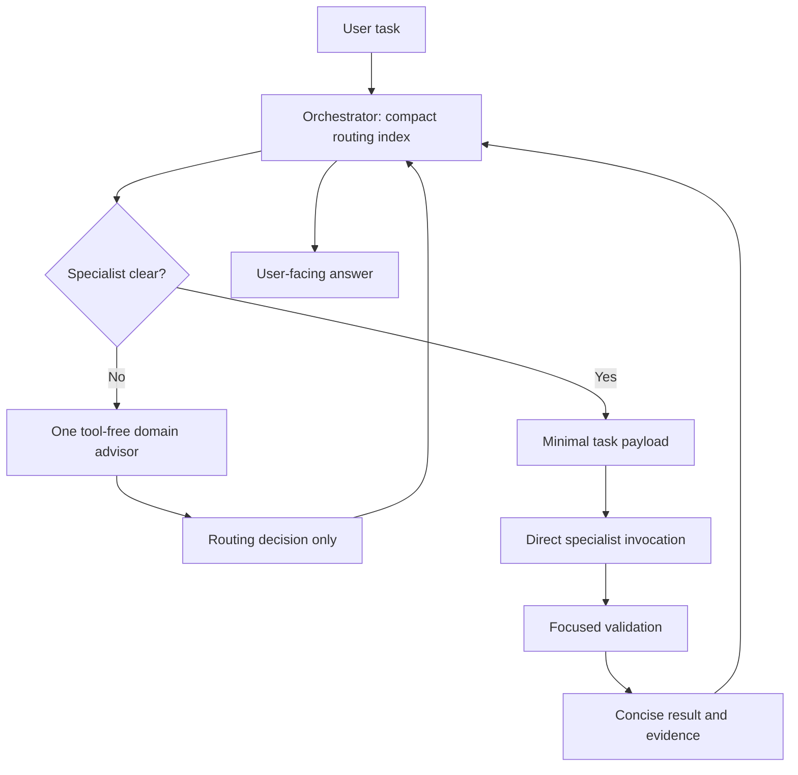
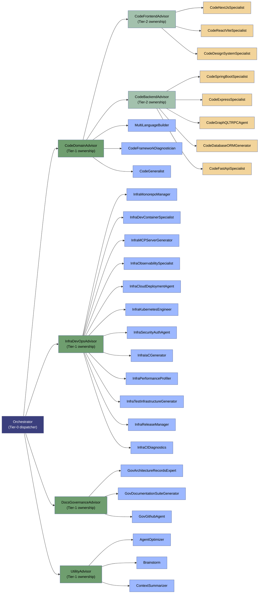

# Agent Roster

This folder holds the definitions of every agent available for routing. Each `.agent.md`
file is a self-contained prompt that governs one agent's behavior, tools, and triggers.

## Architecture

Execution and ownership are separate. **Orchestrator is the only dispatcher**
and directly invokes the selected worker. The compact routing catalog contains
names, ownership, and selection cues, not every specialist's full instructions.
The six former domain routers are now tool-free **advisors**. Clear tasks skip
them; ambiguous tasks consult at most one advisor, which returns a decision to
the dispatcher rather than invoking a worker.

Run Orchestrator as the main chat agent. Workers inspect relevant implementation
locally and return concise evidence. Do not copy whole prompts, chat history, or
unrelated file dumps into their payloads. Independent tasks may use separate
workers, but overlapping edits and dependent interfaces must be sequenced.

This reduces required routing hops and intentional context copying; it does not
guarantee a measured token or latency reduction. The runtime may still expose
agent names and descriptions for discovery. Full specialist prompts must not be
manually loaded into the dispatcher just to select a worker.

## Execution



The advisor and worker are separate calls from the main dispatcher. No subagent
needs to invoke another subagent. An advisor decision is not an execution receipt.

## Ownership

The four-level tree below is organizational, not a required call chain.
The source of truth is [routing-catalog.json](routing-catalog.json). Each non-root
agent has exactly one owner. CodeGeneralist is the coding fallback worker;
advisors never implement changes. Agent filenames now describe their advisory role.




## Agent Index

| Agent | Role | User-invocable | Key Focus |
|---|---|---|---|
| **Orchestrator** | dispatcher | yes | Direct specialist dispatch, scoped payloads, concise synthesis |
| **CodeBackendAdvisor** | advisor | no | Optional backend specialist selection; never executes |
| **DocsGovernanceAdvisor** | advisor | no | Optional docs/governance specialist selection; never executes |
| **InfraDevOpsAdvisor** | advisor | no | Optional infrastructure/DevOps specialist selection; never executes |
| **UtilityAdvisor** | advisor | no | Optional utility specialist selection; never executes |
| **AgentOptimizer** | worker | yes | Diagnostics & optimization of a VS Code agent's definition, tools, and instructions |
| **GovArchitectureRecordsExpert** | worker | no | Manages ADRs and architectural alignments inside `./docs` |
| **Brainstorm** | worker | no | Divergent thinking: generates low-token architectural alternatives & edge cases |
| **CodeDomainAdvisor** | advisor | no | Optional cross-stack coding specialist selection; never executes |
| **CodeGeneralist** | worker | no | Generic implementation, review, debugging, and refactoring when no specialist fits |
| **ContextSummarizer** | worker | no | Read-only checkpoint summaries for observed context pressure or explicit requests; does not reset chat history or runtime context |
| **MultiLanguageBuilder** | worker | no | Polyglot builds across Python/Node.js/TypeScript with package management |
| **InfraDevContainerSpecialist** | worker | no | `.devcontainer/` scaffolding, Dockerfiles, remote SSH, container lifecycle |
| **InfraMCPServerGenerator** | worker | no | Model Context Protocol servers, JSON-RPC, editor integration |
| **CodeReactViteSpecialist** | worker | no | Frontend scaffolding: TypeScript + React + Vite + Vitest |
| **CodeFastApiSpecialist** | worker | no | Backend API scaffolding: FastAPI, Pydantic, SQLAlchemy |
| **InfraMonorepoManager** | worker | no | Multi-package workspace coordination & version synchronization |
| **InfraTestInfrastructureGenerator** | worker | no | Test suites across frameworks + CI/CD pipeline configuration |
| **GovDocumentationSuiteGenerator** | worker | no | ADRs, API docs, READMEs, user documentation |
| **InfraPerformanceProfiler** | worker | no | CPU/memory profiling for Python (Tachyon, Memray) and Node.js |
| **InfraReleaseManager** | worker | no | Version bumping, changelogs, Git tagging, publishing |
| **GovGithubAgent** | worker | no | PR/issue/code-search review, triage, GitHub Projects, agent capability filing |
| **InfraCIDiagnostics** | worker | no | Root-cause diagnosis of failing CI/Actions jobs & PR errors, then suggests fixes |
| **CodeNextJsSpecialist** | worker | no | Next.js architecture: App Router, Server Components, ISR |
| **CodeSpringBootSpecialist** | worker | no | Java/Spring Boot backend scaffolding |
| **CodeDesignSystemSpecialist** | worker | no | Shared UI component libraries & design systems: React/Vue/Angular, theming/tokens, prop types, accessibility |
| **CodeDatabaseORMGenerator** | worker | no | Database schema & ORM setup: SQL/ORM scaffolding, migrations, indexes, constraints; SQLAlchemy/Prisma/Hibernate/Eloquent |
| **CodeFrontendAdvisor** | advisor | no | Optional frontend specialist selection; never executes |
| **CodeGraphQLTRPCAgent** | worker | no | GraphQL API & tRPC scaffolding: schema, resolvers, codegen (Apollo, Hasura, tRPC) |
| **CodeExpressSpecialist** | worker | no | Node.js/Express REST API generation & bootstrapping |
| **InfraCloudDeploymentAgent** | worker | no | Cross-cloud deployment & provisioning: cloud-init, pipelines, container orchestration (Azure DevOps, GitHub Actions) |
| **InfraIaCGenerator** | worker | no | Infrastructure-as-code generation: Bicep/ARM, Terraform, Pulumi |
| **InfraKubernetesEngineer** | worker | no | Kubernetes cluster engineering: Helm/Kustomize manifests, networking, RBAC |
| **InfraSecurityAuthAgent** | worker | no | Security hardening & authentication: RBAC, secrets, JWT/OAuth2/OpenID, compliance |
| **InfraObservabilitySpecialist** | worker | no | Observability engineering: error monitoring, tracing (OpenTelemetry), metrics, alerting |
| **CodeFrameworkDiagnostician** | worker | no | Local error parser & dependency validation for complex framework bugs |

## Routing Rules (Orchestrator)

1. Answer trivial factual questions directly. For work, choose the most-specific
    worker from the compact catalog; do not read every specialist definition.
2. Clear tasks go directly to one worker. Ambiguous tasks may consult one advisor
    with only the task, constraints, and relevant candidate catalog slice.
3. Advisors return JSON with `status`, `agent`, `reason`, and `missing_context`.
    Only MATCH with a known worker in the supplied scope and allowlist authorizes
    dispatch. NEEDS_INPUT requires clarification; NO_MATCH requires reassessment.
4. The dispatcher sends only goal/mode, relevant paths, constraints/approvals,
    acceptance checks, and essential verified evidence. Workers inspect local code.
5. Workers report concise findings/changes, artifact references, validation
    actually run, and blockers. Proposals do not become decisions without approval.
6. Fan out only disjoint independent work. Sequence overlapping edits. Allow one
    focused retry; escalate a real definition defect to AgentOptimizer once.
7. No advisor or worker delegates. No runtime compaction is promised. Do not force
    a checkpoint or questionnaire after each task.

## Domain Map

| Domain Prefix | Advisor | Owned Agents |
|---|---|---|
| CODE_ | CodeDomainAdvisor | CodeFrontendAdvisor, CodeBackendAdvisor, MultiLanguageBuilder, CodeFrameworkDiagnostician, CodeGeneralist |
| CODE_ / Backend | CodeBackendAdvisor | CodeSpringBootSpecialist, CodeExpressSpecialist, CodeGraphQLTRPCAgent, CodeDatabaseORMGenerator, CodeFastApiSpecialist |
| CODE_ / Frontend | CodeFrontendAdvisor | CodeNextJsSpecialist, CodeReactViteSpecialist, CodeDesignSystemSpecialist |
| INFRA_/_DevOps | InfraDevOpsAdvisor | InfraMonorepoManager, InfraDevContainerSpecialist, InfraMCPServerGenerator, InfraCloudDeploymentAgent, InfraKubernetesEngineer, InfraSecurityAuthAgent, InfraIaCGenerator, InfraPerformanceProfiler, InfraTestInfrastructureGenerator, InfraReleaseManager, InfraCIDiagnostics, InfraObservabilitySpecialist |
| GOV_/_Docs | DocsGovernanceAdvisor | GovArchitectureRecordsExpert, GovDocumentationSuiteGenerator, GovGithubAgent |
| Miscellaneous | UtilityAdvisor | AgentOptimizer, Brainstorm, ContextSummarizer |

## Name Migration

Update saved agent selections and external workflow references to these names.
Old filenames were removed; no alias agents are installed. Tools, ownership, and
execution responsibilities are unchanged by this naming migration.

```text
WebDiagnosisExpert                       -> CodeFrameworkDiagnostician
CompactionExpert                         -> ContextSummarizer
InfraDevContainerOrchestrator             -> InfraDevContainerSpecialist
InfraPRCIErrDiagnosticFix                 -> InfraCIDiagnostics
CodeComponentLibraryDesignSystemAgent    -> CodeDesignSystemSpecialist
CodeTypeScriptReactViteGenerator          -> CodeReactViteSpecialist
ObservabilityAgent                       -> InfraObservabilitySpecialist
MiscAdvisor                              -> UtilityAdvisor
CodeNextjsGenerator                      -> CodeNextJsSpecialist
CodePythonFastAPIBuilder                 -> CodeFastApiSpecialist
CodeNodeJsExpressGenerator               -> CodeExpressSpecialist
CodeSpringBootGenerator                  -> CodeSpringBootSpecialist
```

## Notes

- Former DomainRouter definitions were renamed to Advisor definitions; select the
    updated names in saved workflows. Restart/select Orchestrator in a main chat
    when the editor has not refreshed its agent discovery list.
- Orchestrator's `agents:` is the direct invocation allowlist, not ownership.
    Advisors have `tools: []` and `agents: []`; workers have no delegation tool.
- The catalog controls ownership and selection cues; update it, the allowlist,
    and ownership documentation together when adding or renaming an agent.

## Validation

Run the static validator and its in-memory regression suite from this directory:

```powershell
python agent-roster-validator.py
python -m unittest -v test_agent_roster_validator
```

Python and PyYAML are required. Validation checks two distinct contracts: flat
runtime invocation from Orchestrator, and the catalog's single-parent ownership
tree with tier depths and documentation parity. Catalog targets must resolve to
real workers, and advisors must be tool-free. Passing static checks does not
prove output quality, token savings, or runtime agent discovery.

## Runtime Verification

A prior nested-router smoke test on 2026-10-20 stopped at the coding router:
its subagent context had no agent-invocation tool. That failure motivated the
approved single-dispatcher contract. Do not invoke Orchestrator as a subagent and
expect it to delegate; it must be the main chat agent.

The main session exercised both replacement paths with read-only calls on 2026-10-20:

These results predate the naming-only migration above; the same definitions are
identified below by their current names. Runtime discovery under the new names
has not been re-tested; refresh agent selection after the migration.

- Direct worker: CodeReactViteSpecialist reviewed supplied JSX, found
    the missing stable key, and returned a minimal fix without files or commands.
- Optional advisor: CodeFrontendAdvisor returned MATCH for the shared component
    specialist. The main session checked that target against the supplied candidates
    and allowlist, then separately invoked CodeDesignSystemSpecialist.
    That worker returned a scoped approach without files, commands, or nested calls.

These tests verify direct invocation and advisor/worker separation in this session.
They are not a full automatic-routing evaluation of a fresh Orchestrator main
chat, nor a benchmark of context size or output quality. Select the updated
Orchestrator as the main chat agent to use the contract; running it inside another
subagent would reintroduce the known nesting limitation.
