# Agent Roster

This folder holds the definitions of every agent available for routing. Each `.agent.md`
file is a self-contained prompt that governs one agent's behavior, tools, and triggers.

## Architecture

The agents form a **star topology**: the `Orchestrator` is the sole central routing
layer. It never performs work itself — it analyzes an incoming task, routes it to the
single most appropriate specialist (or fans out to several), then synthesizes their
results into one coherent answer. The 18 subagents are **leaf nodes**: they perform
work but never route to other agents.

```mermaid
flowchart TB
    O["Orchestrator<br/>(central routing layer)"]
    O --> CodeImplementer
    O --> ArchitectureRecordsExpert
    O --> WebDiagnosisExpert
    O --> Brainstorm
    O --> CompactionExpert
    O --> MultiLanguageBuilder
    O --> DevContainerOrchestrator
    O --> MCPServerGenerator
    O --> TypeScriptReactViteGenerator
    O --> PythonFastAPIBuilder
    O --> MonorepoManager
    O --> TestInfrastructureGenerator
    O --> DocumentationSuiteGenerator
    O --> PerformanceProfiler
    O --> ReleaseManager
    O --> github_agent
    O --> NextjsGenerator
    O --> NodeJsExpressGenerator
    O --> SpringBootGenerator

    classDef hub fill:#3b3f7d,stroke:#e0e0e0,color:#fff;
    classDef leaf fill:#9db8ff,stroke:#516399,color:#000;
    class O hub;
    class CodeImplementer,ArchitectureRecordsExpert,WebDiagnosisExpert,Brainstorm,CompactionExpert,MultiLanguageBuilder,DevContainerOrchestrator,MCPServerGenerator,TypeScriptReactViteGenerator,PythonFastAPIBuilder,MonorepoManager,TestInfrastructureGenerator,DocumentationSuiteGenerator,PerformanceProfiler,ReleaseManager,github_agent,NextjsGenerator,NodeJsExpressGenerator,SpringBootGenerator leaf;

```

## Agent Index

| Agent | Invocation | User-invocable | Key Focus |
|---|---|---|---|
| **Orchestrator** | yes | yes | Pure routing layer; routes tasks to specialists, synthesizes results |
| **Agent Optimizer** | yes | yes | Diagnostics & optimization of a VS Code agent's definition, tools, and instructions |
| **Architecture Records Expert** | no | no | Manages ADRs and architectural alignments inside `./docs` |
| **Brainstorm** | no | no | Divergent thinking: generates low-token architectural alternatives & edge cases |
| **CodeImplementer** | no | no | Implements/refactors/fixes code with zero prose; atomic, typed edits |
| **Compaction Expert** | no | no | Shrinks conversation logs (~every 3 turns) to protect VRAM while preserving state |
| **MultiLanguage Builder** | no | no | Polyglot builds across Python/Node.js/TypeScript with package management |
| **Dev Container Orchestrator** | no | no | `.devcontainer/` scaffolding, Dockerfiles, remote SSH, container lifecycle |
| **MCP Server Generator** | no | no | Model Context Protocol servers, JSON-RPC, editor integration |
| **TypeScript React Vite Generator** | no | no | Frontend scaffolding: TypeScript + React + Vite + Vitest |
| **Python FastAPI Builder** | no | no | Backend API scaffolding: FastAPI, Pydantic, SQLAlchemy |
| **Monorepo Manager** | no | no | Multi-package workspace coordination & version synchronization |
| **Test Infrastructure Generator** | no | no | Test suites across frameworks + CI/CD pipeline configuration |
| **Documentation Suite Generator** | no | no | ADRs, API docs, READMEs, user documentation |
| **Performance Profiler** | no | no | CPU/memory profiling for Python (Tachyon, Memray) and Node.js |
| **Release Manager** | no | no | Version bumping, changelogs, Git tagging, publishing |
| **github-agent** | no | no | PR/issue/code-search review, triage, GitHub Projects, agent capability filing |
| **NextjsGenerator** | no | no | Next.js architecture: App Router, Server Components, ISR |
| **NodeJsExpressGenerator** | no | no | Node.js/Express REST API bootstrapping |
| **SpringBootGenerator** | no | no | Java/Spring Boot backend scaffolding |

## Routing Rules (Orchestrator)

The Orchestrator follows a strict routing policy:

1. **Trivial-task short-circuit** — answer simple questions/lookups directly, don't route.
2. **Specialized builders win** — pick the most specific match (e.g., ADRs → Architecture Records Expert, not Documentation Suite Generator).
3. **GitHub / agent-capability workflows** → `github-agent`.
4. **Fan-out** — decompose independent multi-part tasks and dispatch each to its own specialist in parallel.
5. **Post-routing self-check** — verify results against acceptance criteria; bounded re-attempt, then escalate to Agent Optimizer once.

## Notes

- `NextjsGenerator` and `TypeScriptReactViteGenerator` are both React-focused; the Orchestrator routes Next.js-specific work to `NextjsGenerator` and Vite-based SPA work to `TypeScriptReactViteGenerator`.
- Each `.agent.md` file lives at `c:\Users\Steeve\AppData\Roaming\Code\User\prompts\<Agent>.agent.md` and is loaded into the Orchestrator's routing context at invocation time.
