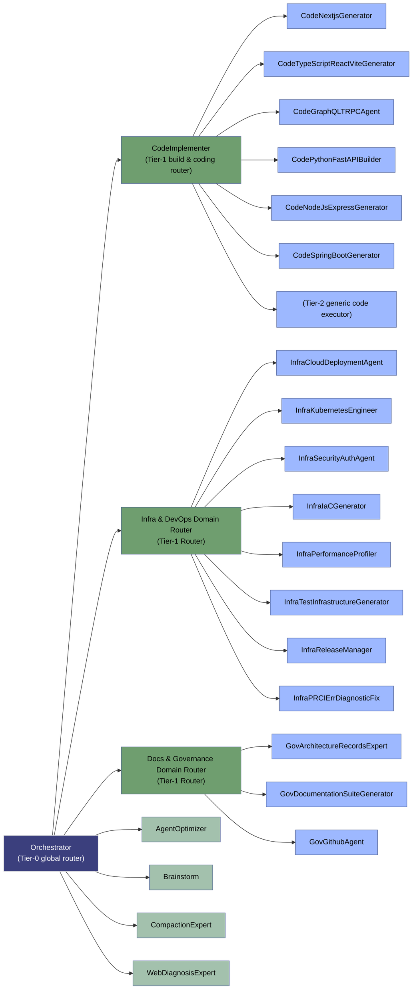

# Agent Roster

This folder holds the definitions of every agent available for routing. Each `.agent.md`
file is a self-contained prompt that governs one agent's behavior, tools, and triggers.

## Architecture

The agents form a **3-tier tree topology**. The `Orchestrator` is the **Tier-0**
global router: it never performs work itself — it classifies an incoming task into a
domain, selects a **Tier-1** (a domain router or `CodeImplementer`), which then routes
to exactly one **Tier-2 leaf** specialist. `CodeImplementer` is the **build & coding**
Tier-1 router: it routes all code-building tasks (Next.js, React, FastAPI,
Node.js/Express, Spring Boot) to their specialized leaves and falls back to a generic
code executor when no specialist matches. Cross-cutting agents (Agent Optimizer,
Brainstorm, Compaction Expert, Web Diagnosis Expert) live at the root and are invoked
by the Orchestrator for special-purpose diagnostics, not for routine routing.

This hierarchy reduces routing context cost (each router only carries its own
leaves), enables clean composition, deduplicates overlapping specialists, and
scales the roster by adding routers or leaves locally.

## Agent Index

| Agent | Invocation | User-invocable | Key Focus |
|---|---|---|---|
| **Orchestrator** | yes | yes | Pure routing layer; routes tasks to specialists, synthesizes results |
| **CodeBackendDomainRouter** | no | no | Backend-router sub-layer; routes backend-scaffolding tasks to a single leaf agent |
| **DocsGovernanceDomainRouter** | no | no | Docs/Governance sub-layer; routes documentation, ADR, and governance tasks to a single leaf agent |
| **InfraDevOpsDomainRouter** | no | no | Infra/DevOps sub-layer; routes infra, DevOps, and tooling tasks to a single leaf agent |
| **AgentOptimizer** | yes | yes | Diagnostics & optimization of a VS Code agent's definition, tools, and instructions |
| **GovArchitectureRecordsExpert** | no | no | Manages ADRs and architectural alignments inside `./docs` |
| **Brainstorm** | no | no | Divergent thinking: generates low-token architectural alternatives & edge cases |
| **CodeImplementer** | no | no | Implements/refactors/fixes code with zero prose; atomic, typed edits |
| **CompactionExpert** | no | no | Context containment utility; shrinks conversation logs to protect VRAM |
| **MultiLanguageBuilder** | no | no | Polyglot builds across Python/Node.js/TypeScript with package management |
| **InfraDevContainerOrchestrator** | no | no | `.devcontainer/` scaffolding, Dockerfiles, remote SSH, container lifecycle |
| **InfraMCPServerGenerator** | no | no | Model Context Protocol servers, JSON-RPC, editor integration |
| **CodeTypeScriptReactViteGenerator** | no | no | Frontend scaffolding: TypeScript + React + Vite + Vitest |
| **CodePythonFastAPIBuilder** | no | no | Backend API scaffolding: FastAPI, Pydantic, SQLAlchemy |
| **InfraMonorepoManager** | no | no | Multi-package workspace coordination & version synchronization |
| **InfraTestInfrastructureGenerator** | no | no | Test suites across frameworks + CI/CD pipeline configuration |
| **GovDocumentationSuiteGenerator** | no | no | ADRs, API docs, READMEs, user documentation |
| **InfraPerformanceProfiler** | no | no | CPU/memory profiling for Python (Tachyon, Memray) and Node.js |
| **InfraReleaseManager** | no | no | Version bumping, changelogs, Git tagging, publishing |
| **GovGithubAgent** | no | no | PR/issue/code-search review, triage, GitHub Projects, agent capability filing |
| **InfraPRCIErrDiagnosticFix** | no | no | Root-cause diagnosis of failing CI/Actions jobs & PR errors, then suggests fixes |
| **CodeNextjsGenerator** | no | no | Next.js architecture: App Router, Server Components, ISR |
| **CodeSpringBootGenerator** | no | no | Java/Spring Boot backend scaffolding |
| **CodeComponentLibraryDesignSystemAgent** | no | no | Shared UI component libraries & design systems: React/Vue/Angular, theming/tokens, prop types, accessibility |
| **CodeDatabaseORMGenerator** | no | no | Database schema & ORM setup: SQL/ORM scaffolding, migrations, indexes, connection pooling, seeding; SQLAlchemy/Prisma/Hibernate/Eloquent |
| **CodeFrontendDomainRouter** | yes | no | Frontend-router sub-layer; routes frontend-scaffolding tasks to a single leaf agent |
| **CodeGraphQLTRPCAgent** | no | no | GraphQL API & tRPC scaffolding: schema, resolvers, codegen (Apollo, Hasura, tRPC) |
| **CodeNodeJsExpressGenerator** | no | no | Node.js/Express REST API generation & bootstrapping |
| **InfraCloudDeploymentAgent** | no | no | Cross-cloud deployment & provisioning: cloud-init, pipelines, container orchestration (Azure DevOps, GitHub Actions) |
| **InfraIaCGenerator** | no | no | Infrastructure-as-code generation: Bicep/ARM, Terraform, Pulumi |
| **InfraKubernetesEngineer** | no | no | Kubernetes cluster engineering: Helm/Kustomize manifests, networking, RBAC |
| **InfraSecurityAuthAgent** | no | no | Security hardening & authentication: RBAC, secrets, JWT/OAuth2/OpenID, compliance |
| **ObservabilityAgent** | no | no | Observability engineering: error monitoring, tracing (OpenTelemetry), metrics, alerting |
| **WebDiagnosisExpert** | no | no | Local error parser & dependency validation for complex framework bugs |

## Routing Rules (Orchestrator)

The Orchestrator routes **Tier-1** only. It first classifies the task into a domain,
then hands it to that domain's router. Each router then applies its own sub-rules to
pick the single Tier-2 leaf.

**Tier-0 — Orchestrator (global classification)**
1. **Trivial-task short-circuit** — answer simple questions/lookups directly, don't route.
2. **Domain classification** — map the task to a domain prefix: `CODE_` (for all building/coding tasks), `INFRA_` (for infrastructure/DevOps), or `GOV_` (for documentation/governance) (see *Domain Map* ).
3. **Cross-cutting diagnostics** — Agent Optimizer / Brainstorm / Compaction Expert / Web Diagnosis Expert / MultiLanguage Builder handle special-purpose diagnostics, not routine routing.
4. **GitHub / agent-capability workflows** → route to `GovGithubAgent` (via the GOV_ router).
5. **Failing CI / GitHub Actions jobs and PR errors needing root-cause diagnosis + fix** → route to `InfraPRCIErrDiagnosticFix` (via the INFRA_ router).
6. **Default** — if no clear domain emerges, route to the most general-capable router.

**Tier-1 — Routers**
- **CODE_ (Coding & Build Router)** — code-building tasks: Next.js → `CodeNextjsGenerator`; Vite SPA → `CodeTypeScriptReactViteGenerator`; GraphQL/tRPC → `CodeGraphQLTRPCAgent`; FastAPI → `CodePythonFastAPIBuilder`; Node.js+Express → `CodeNodeJsExpressGenerator`; Spring Boot → `CodeSpringBootGenerator`. Falls back to the generic code executor when no specialist matches.
- **INFRA_ (Infra & DevOps Router)**: Monorepo → `InfraMonorepoManager`; dev container → `InfraDevContainerOrchestrator`; MCP → `InfraMCPServerGenerator`; profiling → `InfraPerformanceProfiler`; tests → `InfraTestInfrastructureGenerator`; release → `InfraReleaseManager`; CI/Actions failure diagnosis → `InfraPRCIErrDiagnosticFix`.
- **GOV_ (Docs & Governance Router)**: ADRs → `GovArchitectureRecordsExpert`; docs → `GovDocumentationSuiteGenerator`; GitHub → `GovGithubAgent`.
- **Fan-out** — decompose independent multi-part tasks and dispatch each to its own specialist in parallel.
- **Post-routing self-check** — verify results against acceptance criteria; bounded re-attempt, then escalate to Agent Optimizer once.

## Domain Map

| Domain Prefix | Router | Leaves |
|---|---|---|
| CODE_ | CodeImplementer | CodeNextjsGenerator, CodeTypeScriptReactViteGenerator, CodeGraphQLTRPCAgent, CodePythonFastAPIBuilder, CodeNodeJsExpressGenerator, CodeSpringBootGenerator |
| INFRA_ | Infra & DevOps Domain Router | InfraMonorepoManager, InfraDevContainerOrchestrator, InfraMCPServerGenerator, InfraPerformanceProfiler, InfraTestInfrastructureGenerator, InfraReleaseManager, InfraPRCIErrDiagnosticFix |
| GOV_ | Docs & Governance Domain Router | GovArchitectureRecordsExpert, GovDocumentationSuiteGenerator, GovGithubAgent |

## Notes

- All coding tasks (Next.js, React SPA, GraphQL/tRPC, FastAPI, Node.js/Express, Spring Boot) are routed through `CodeImplementer` to their specialized builder; work with no specialist match falls back to the generic code executor.
- Each `.agent.md` file lives at `c:\Users\Steeve\AppData\Roaming\Code\User\prompts\<Agent>.agent.md` and is loaded into the Orchestrator's routing context at invocation time.
- **Failing CI / GitHub Actions jobs and PR errors** needing root-cause diagnosis + fix route to `InfraPRCIErrDiagnosticFix` (via the Infra & DevOps router).
- Each domain router only carries its own leaves in its frontmatter `agents:` list, so routing decisions for that domain are made without any other tier's agents present in context.
