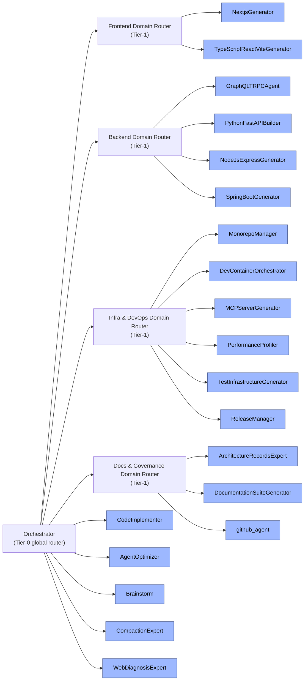

# Agent Roster

This folder holds the definitions of every agent available for routing. Each `.agent.md`
file is a self-contained prompt that governs one agent's behavior, tools, and triggers.

## Architecture

The agents form a **3-tier tree topology**. The `Orchestrator` is the **Tier-0**
global router: it never performs work itself — it classifies an incoming task into a
domain, selects a **Tier-1 domain router**, which then routes to exactly one **Tier-2
leaf** specialist. Cross-cutting agents (Agent Optimizer, Brainstorm, Compaction
Expert, Agent Optimizer, Web Diagnosis Expert) live at the root and are invoked by
the Orchestrator for special-purpose diagnostics, not for routine routing.

This hierarchy reduces routing context cost (each router only carries its own
leaves), enables clean composition, deduplicates overlapping specialists, and
scales the roster by adding routers or leaves locally.

## Agent Index

| Agent | Invocation | User-invocable | Key Focus |
|---|---|---|---|
| **Orchestrator** | yes | yes | Pure routing layer; routes tasks to specialists, synthesizes results |
| **Agent Optimizer** | yes | yes | Diagnostics & optimization of a VS Code agent's definition, tools, and instructions |
| **Architecture Records Expert** | no | no | Manages ADRs and architectural alignments inside `./docs` |
| **Brainstorm** | no | no | Divergent thinking: generates low-token architectural alternatives & edge cases |
| **CodeImplementer** | no | no | Implements/refactors/fixes code with zero prose; atomic, typed edits |
| **Compaction Expert** | no | no | Shrinks conversation logs (~every 3 turns) to protect VRAM while preserving state |
| **MultiLanguage Builder** | no | no | Polyglot builds across Python/Node.js/TypeScript with package management |
| **Dev Container Orchestrator** | no | no | `.devcontainer/` scaffolding, Dockerfiles, remote SSH, container lifecycle |
| **MCP Server Generator** | no | no | Model Context Protocol servers, JSON-RPC, editor integration |
| **TypeScript React Vite Generator** | no | no | Frontend scaffolding: TypeScript + React + Vite + Vitest |
| **Python FastAPI Builder** | no | no | Backend API scaffolding: FastAPI, Pydantic, SQLAlchemy |
| **Monorepo Manager** | no | no | Multi-package workspace coordination & version synchronization |
| **Test Infrastructure Generator** | no | no | Test suites across frameworks + CI/CD pipeline configuration |
| **Documentation Suite Generator** | no | no | ADRs, API docs, READMEs, user documentation |
| **Performance Profiler** | no | no | CPU/memory profiling for Python (Tachyon, Memray) and Node.js |
| **Release Manager** | no | no | Version bumping, changelogs, Git tagging, publishing |
| **github-agent** | no | no | PR/issue/code-search review, triage, GitHub Projects, agent capability filing |
| **NextjsGenerator** | no | no | Next.js architecture: App Router, Server Components, ISR |
| **NodeJsExpressGenerator** | no | no | Node.js/Express REST API bootstrapping |
| **GraphQLTRPCAgent** | no | no | GraphQL schema/resolvers or tRPC end-to-end typing |
| **SpringBootGenerator** | no | no | Java/Spring Boot backend scaffolding |

## Routing Rules (Orchestrator)

The Orchestrator routes **Tier-1** only. It first classifies the task into a domain,
then hands it to that domain's router. Each router then applies its own sub-rules to
pick the single Tier-2 leaf.

**Tier-0 — Orchestrator (global classification)**
1. **Trivial-task short-circuit** — answer simple questions/lookups directly, don't route.
2. **Domain classification** — map the task to a domain: Frontend, Backend, Infra & DevOps, or Docs & Governance (see *Domain Map*).
3. **Cross-cutting diagnostics** — Agent Optimizer / Brainstorm / Compaction Expert / Web Diagnosis Expert handle special-purpose diagnostics, not routine routing.
4. **GitHub / agent-capability workflows** → route to `github-agent` (via the Docs & Governance router).
5. **Default** — if no clear domain emerges, route to the most general-capable router.

**Tier-1 — Domain routers (sub-rules)**
- **Frontend**: Next.js → `NextjsGenerator`; Vite SPA → `TypeScriptReactViteGenerator`.
- **Backend**: GraphQL/tRPC → `GraphQLTRPCAgent`; FastAPI → `PythonFastAPIBuilder`; Node.js+Express → `NodeJsExpressGenerator`; Spring Boot → `SpringBootGenerator`.
- **Infra & DevOps**: Monorepo → `MonorepoManager`; dev container → `DevContainerOrchestrator`; MCP → `MCPServerGenerator`; profiling → `PerformanceProfiler`; tests/CI → `TestInfrastructureGenerator`; release → `ReleaseManager`.
- **Docs & Governance**: ADRs → `ArchitectureRecordsExpert`; docs → `DocumentationSuiteGenerator`; GitHub → `github-agent`.
- **Fan-out** — decompose independent multi-part tasks and dispatch each to its own specialist in parallel.
- **Post-routing self-check** — verify results against acceptance criteria; bounded re-attempt, then escalate to Agent Optimizer once.

## Domain Map

| Domain | Router | Leaves |
|---|---|---|
| Frontend | Frontend Domain Router | NextjsGenerator, TypeScriptReactViteGenerator |
| Backend | Backend Domain Router | GraphQLTRPCAgent, PythonFastAPIBuilder, NodeJsExpressGenerator, SpringBootGenerator |
| Infra & DevOps | Infra & DevOps Domain Router | MonorepoManager, DevContainerOrchestrator, MCPServerGenerator, PerformanceProfiler, TestInfrastructureGenerator, ReleaseManager |
| Docs & Governance | Docs & Governance Domain Router | ArchitectureRecordsExpert, DocumentationSuiteGenerator, github-agent |

## Notes

- `NextjsGenerator` and `TypeScriptReactViteGenerator` are both React-focused; the Orchestrator routes Next.js-specific work to `NextjsGenerator` and Vite-based SPA work to `TypeScriptReactViteGenerator`.
- Each `.agent.md` file lives at `c:\Users\Steeve\AppData\Roaming\Code\User\prompts\<Agent>.agent.md` and is loaded into the Orchestrator's routing context at invocation time.
- Each domain router only carries its own leaves in its frontmatter `agents:` list, so routing decisions for that domain are made without any other tier's agents present in context.
